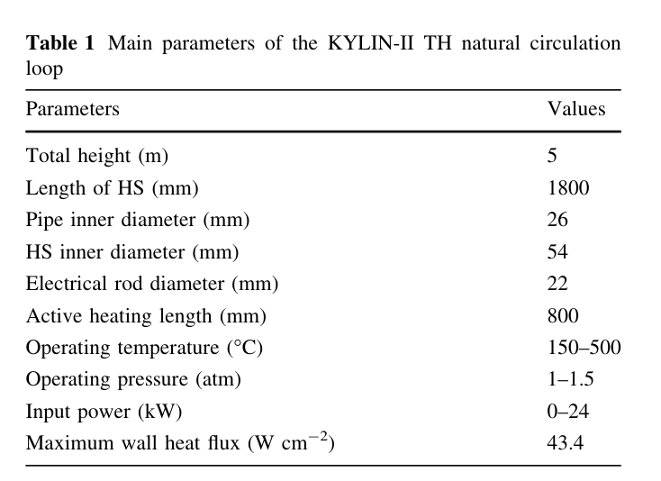
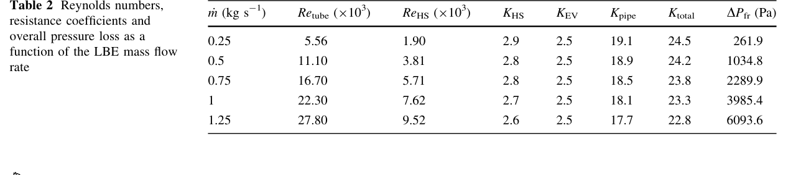
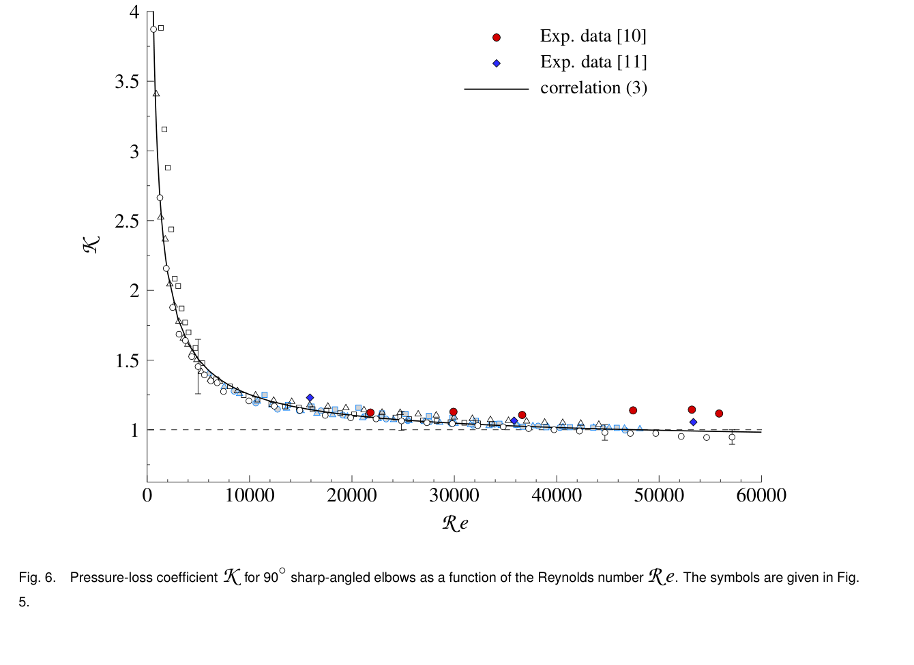
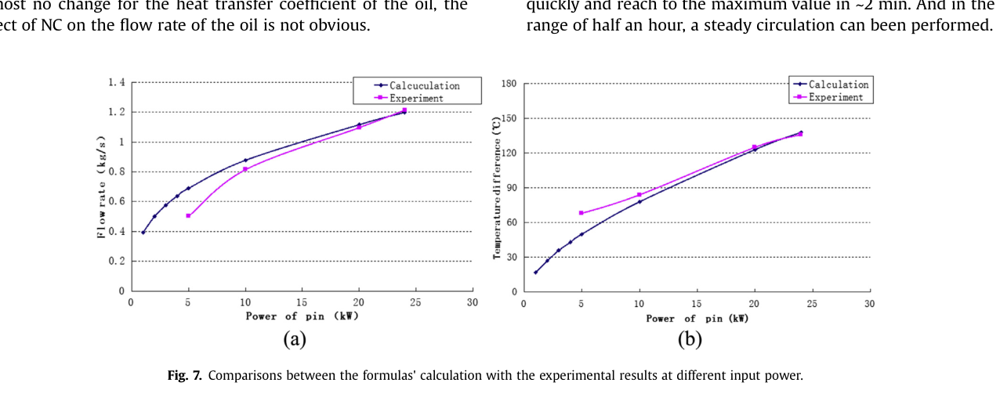

# 逐构件 `K(Re)` 复核：通用指数失效，KYLIN 单侧几何与阻力得到一手锚点

**2026-11-03。** 选用用户上传的 [Al‑Tameemi 与 Ricco 斜接弯头原稿](altameemi-ricco-mitre-original-20261103.pdf)、[Li 等 2015](li-2015-kylin-original-20261103.pdf)、[Yue 等 2017](yue-2017-kylin-original-20261103.pdf)，核查[第九轮报告](component-re-v2-upload-report-20261103.html)、[脚本](component-re-v2-upload-script-20261103.py)、[日志](component-re-v2-upload-log-20261103.txt)。上传脚本重跑 **262 行与日志一致**；[独立算术脚本](component-re-independent-audit-20261103.py)与[逐行 CSV](yue-2017-table2-resistance-20261103.csv)单独交付。以下区分原文事实、理论表、条件算式与物理转用。

## 选用了什么，依据是什么

| 工作对象 | 一手坐标 | 用途与证据等级 |
|---|---|---|
| 90° 圆管锐角斜接弯头 | Al‑Tameemi–Ricco 上传稿 PDF 第 5 页式(4)、第 16 页 Fig. 6 | 反驳“所有局阻都有 `m≤0.2`”的**通用假设**；仅适用于该构件、该 Re 区间，不能直接赋给 KYLIN |
| KYLIN-II TH 的加热段和主管 | Yue 2017 PDF 第 2 页 Table 1 与 §2 原句 | 建立**名义单侧流通几何**，替换“棒数未知”的旧记述 |
| KYLIN 单侧阻力 | Yue PDF 第 3 页式(3)、(6)–(9)，第 4 页 Table 2 | 提取同一参考动压下的**作者理论计算**；不是实测局阻，也没有缩比另一侧 |
| 实验与留出点 | Li 2015 PDF 第 2、5 页，Yue PDF 第 5–6 页 | 确认流量测量口径、功率点和热损/阀门条件，给模型外部对照设门禁 |

## KYLIN 加热段几何：先前的空格可以收窄

{width=67%}

Yue §2 明写**一根电加热棒同心插入** 54 mm 内径加热管；Table 1 给主管内径 26 mm、棒径 22 mm。由此，在“同心圆环、忽略支撑物阻塞”的**名义几何条件**下：

| 量 | 计算值 | 等级 |
|---|---:|---|
| 主管流通面积 `pi*0.026^2/4` | `5.30929e-4 m^2` | L2：由 Yue Table 1 的 L1 内径计算 |
| 加热段环隙面积 `pi*(0.054^2-0.022^2)/4` | `1.91009e-3 m^2` | L2：由 Yue Table 1 与 §2 的单根同心棒计算 |
| 加热段水力直径 `0.054−0.022` | `32 mm` | L2：理想同心环隙 |
| 加热段/主管面积比 | `3.59763` | L2：名义几何 |
| Yue 式(8) 的参考动压面积因子 `(A_pipe/A_HS)²` | `0.077262` | L2：名义几何 |

所以旧“KYLIN 加热段棒数未知，54/22 mm 在 Xu 表 1”的表述应改：**54/22 mm 与单根同心棒来自 Yue 2017 Table 1/§2，Xu FR26 Table 1 不含它们。** 支撑件、间隙与实际有效面积未报告，不能把名义面积说成验收值；这份资料仍不能给 Zhao 另一套装置的净面积。

## KYLIN 单侧阻力：拿到了模型基线，也看见闭合冲突

{width=100%}

Yue §3.2 把 `K_total=K_HS+K_EV+K_pipe`，并在式(9)明确写 `K_pipe=f L_pipe/D+1`；“`+1`”来自两只 90° 弯头各 `K=0.5`，主管长度约 **11 m 是作者采用的保守假设**。`K_EV≈2.5` 基于其“previous experience”；Table 2 的五行属 **§3.3 preliminary theoretical analysis**，不是逐段压差实测。

| 作者给的流量 | `K_total` | `K_pipe−1`（管段沿程摩擦） | `(K_pipe−1)/K_total` |
|---:|---:|---:|---:|
| `0.25 kg/s` | `24.5` | `18.1` | `73.88%` |
| `0.50 kg/s` | `24.2` | `17.9` | `73.97%` |
| `0.75 kg/s` | `23.8` | `17.5` | `73.53%` |
| `1.00 kg/s` | `23.3` | `17.1` | `73.39%` |
| `1.25 kg/s` | `22.8` | `16.7` | `73.25%` |

因 `K_HS` 还含加热段摩擦，**Yue 这套理论闭合的沿程份额至少约 73%**。这与我们先前四段模型用 24 kW 单点反标定的 `w≈48.67%` 不一致；它们分别是两套**模型值**，不能宣称物理台架已证明哪套正确。具体应重查 `f、L_pipe、K_local` 与热路闭合。例如在 Yue `1.25 kg/s` 行，式(9)与 `D=26 mm、L_pipe≈11 m、Re_tube=27800` 合起来隐含 Darcy `f≈0.03947`；光滑管 Blasius `0.3164 Re^-0.25≈0.02450`，两者相差约 **61%**。这比继续给 `δ` 猜一档数值更直接地暴露阻力域问题。

在五行表内，`K_total` 随主管 Re 从 `5.56×10³` 至 `27.8×10³` 的**端点平均指数约 0.0447**。这只是**该理论总阻力**的表内斜率，不能升级为“所有构件 `m_i≤0.2`”或原型—台架的 `δ` 范围。`K_pipe` 混合管摩擦、换热段和弯头，`K_HS` 混合出入口损失与环隙摩擦，也不可作为纯局阻逐构件实测。

## 斜接弯头：通用 A2 有反例，适用边界必须写准

{width=78%}

原稿第 5 页式(4)为 `K=427.5 Re^(-0.77)+0.9`，**500≤Re≤60000**，实验流体为水与空气，构件为圆管 **90° 锐角斜接弯头**。原文写的是“fits our experimental data within an **average error** of ±3%”，**不是逐点最大误差，更不是可用于区间认证的 ±3% 包络**。局部正指数要写作 `m(Re)=−d ln K/d ln Re=0.77·427.5Re^-0.77/K`；上传报告把它标为 `d ln K/d ln Re`，漏了负号。

| 检查 | 独立结果 | 对上传结论的处理 |
|---|---:|---|
| `m(500)` / `m(10000)` / `m(20000)` | `0.6150 / 0.2181 / 0.1448` | 数值成立 |
| `m(Re)=0.2` 的精确交点 | **`Re≈11666`** | “只有 Re≳20000 后成立”改为“约 1.17×10⁴ 起”；20000 是保守示例，不是交点 |
| `Re_M=500,Re_P=60000` | 实比 `4.518`，`r^-0.2=2.605` | 数值反例成立，**但 Re_M=500 不满足前轮 A1 的‘两侧均湍流’** |
| `Re_M=4000,Re_P=12000` | 实比 `1.340`，`r^-0.2=1.246` | 关联式内、两侧按常见管流门槛属湍流的**更贴近 A1 的反例**；临界附近流态和拟合误差仍须注明 |

这足以否定“分离损失的 Re 指数普遍不超过 0.2”的**普遍命题**。它**没有证明 KYLIN 的 90° 弯头就是这种锐角斜接构件**；Yue 假定两只弯头各 `K=0.5`，与这份锐角斜接弯头数据也不是同一构件定义。上传 B2 的矩形风管表、B3/B5 的 Crane 二手转录尚无原表，本轮不用于 KYLIN 定量；“某张手册从 Re=10⁴ 起”也不能推出“Re<10⁴ 没有可用关系式”。Borda–Carnot 是有适用条件的理想突扩式，不能宣称该类构件的实测 `m` 恒等于零。

## 逐构件混合式与 Re 联立：修正对象和量词

在同一主管参考动压下，令 `κ_i=K_i(A_ref/A_i)²` 为第 `i` 项**等效回路系数**，`α_i=κ_i,P/Σκ_j,P`。若两侧部件集合可逐项配对，精确恒等式是：

`δ = Σ_i α_i [κ_i,M/κ_i,P − 1]`。

此处 `κ_i,M/κ_i,P` 既受 **Re**，也受构件几何、阀门开度、相对面积和所选参考速度影响。只有在**各部件共享同一个 Re 比 `r`**，且 `K_i` 在相应 Re 区间恰为幂律时，才能替换为 `r^(−m_i)`；若指数随 Re 变，须用该区间的**积分平均指数**。上传的 `δ_mix=Σα_i(r^-m_i−1)` 因而是**情景模型式**，不是无条件精确式。没有 `α_i`，也没有每个实际构件的几何和开度，`δ` 仍是待定输入；一个假定 `m_max` 只给条件上包络。

上传算出的 `δ_allow=+0.5389%` 和假设 `m=.2` 时 `Re_R≥0.97348`，**在 Zhao 的拟合值 `w=0.291472` 下算术成立**。该 `w` 是取 `δ=0` 且有效入热等于设计入热时用同一 CFD 输出反演的，不是 Zhao 的“真实摩擦份额”。若改用前轮焓代理闭合得到的条件 `w≈0.36869`，相同目标点的允许 `δ` 已是 `−3.13%`；可见 `0.97348` 不是装置固有门槛。回代 `δ_env(Re(x))` 求出的 `+7.6%～+8.5%` 是**把待验证上界取成等号的最坏情景根**，既不是对实物 `δ` 的估计，也未由上传的二分程序证明全域唯一性；在 A2 已有反例时，更不能称认证上界。

此外，上传写“`x↑ ⇒ 流量增大 ⇒ Re_R↓`”中的流量方向错了：`x=(m_P/m_M)/R_id` 且原型固定，`x↑` 意味**台架流量下降**，所以 `Re_M` 下降。正反馈的代数方向可以在所选模型中讨论，但不能由此宣称解唯一或物理不稳定。`Re=4*m_dot/(pi*D*mu)` 只直接适用于圆管；Yue 的加热段是环隙，需用其 `A_HS,D_h` 单独计算 Re。上传把 `w_+=16.36>1` 直接叫 KYLIN “3% 带整段覆盖”也只检查了**上边界**；在其 `δ=0` 模型下重新算 `w=0/1` 的偏差约 `0/−0.0259%`，所以**该特定模型**确实全域贴近零，不能跨到真实阀门配置。

## 两篇 KYLIN 原文给外部验证设了更清楚的门槛

{width=93%}

Li §2 明说主回路流量由功率平衡计算；正文第 5 页写 24 kW、**阀门最大开度**、二次油约 `1.0 kg/s` 时实验流量 **`1.21 kg/s`**（摘要约为 `1.2`）。Li Fig. 7 与正文还指出低功率约 5 kW 的理论/实验温差差异**超过 26%**，归因于冷段散热风扇。Yue §5.1 同样说实验流量按**加热段功率和进出口温差反算**；§5.2 给 17.9 kW 时理论/实验/CFD 流量 **`1.10/1.12/1.20 kg/s`**，并指出 CFD 假设绝热、且未模拟横支阀门。实验“流量”与同一加热段温差**不独立**。

所以以前用 Li 摘要 `24 kW→1.2 kg/s` 标定的 `k_total=11.593` 只有**圆整锚点**，不能假装精确；17.9 kW 点可以作为候选留出对照，但还需核定阀门开度、油侧条件、热量控制体，并固定模型参数后再预测。Yue Table 3 的 4/8/12/16/20/24 kW 是**理论分析矩阵**，不得当实验留出集。Li 与 Yue 是同一 KYLIN 设施且作者组重合，不能把它们当作两个独立装置的验证。

## 目前推进到哪一步

1. **已完成的小突破：** KYLIN 名义环隙面积和水力直径从 Yue 原文落地；Yue 单侧理论阻力表提供 `K_pipe−1` 与摩擦闭合的可复算基线；通用 `m≤0.2` 在特定构件上有一手反例。
2. **尚未完成的物理域：** KYLIN 阀门开度及实际 `K(Re)`、构件清单、管粗糙度、原型—缩比台架**两侧**同口径阻力和热损。Al‑Tameemi 的水/空气锐角斜接弯头不能替代这些输入。
3. **下一轮最小可检验任务：** 先在 KYLIN 的单侧理论模型中固定 `11 m、26 mm、54/22 mm`，逐项重算 Yue Table 2 和 Li/Yue 各功率的流量；对照 `f≈0.03947` 与 Blasius `0.02450` 的来源，固定 24 kW 参数后只预测 17.9 kW 点。未通过就先修摩擦和热损闭合。通过后才为成对缩比盒和 GSA 赋域，不把通用弯头指数当成 `δ` 先验认证。

**来源限制：** Al‑Tameemi 上传的是“Accepted for publication”的原稿，PDF 本身未给可核 DOI/正式卷页；本轮按作者、题名、式(4)和 PDF 页码引用，不将上传文件名中的年份当正式出版信息。Li 图中未标数字的点只作图形证据，没有从图上臆造精确流量。

分析采用 norman-paper-reading 技能｜作者：N同学｜小红书：N同学｜B站/抖音：耐心的N同学

Analysis performed using the norman-paper-reading skill | Author: N同学 | Xiaohongshu: N同学 | Bilibili/Douyin: 耐心的N同学
