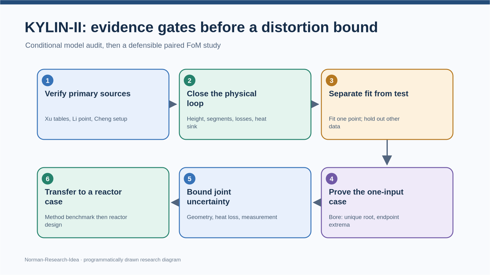

# KYLIN-II 缩比模型复核与下一步研究路线

**日期：2026-11-01；模式：聚焦复核 + 研究方案。** 本轮使用 `norman-paper-reading` 检查上传 HTML 的关键论断、公式和代码证据，使用 `norman-research-idea` 以反例审查候选研究路线。直接运行了上传的 `loop_scaling_certified.py`；运行日志除换行格式外与上传日志一致。另写了独立的标准库复算脚本和情景 CSV。**尚未取得 HTML 所引用的 Xu、Li、Cheng、Yue 论文原文**，因此论文表格、实测数值与跨装置比较目前只能标为“上传 HTML 的转述”，不能称为本轮原文核验。仓库中 Carnevali 2025 原文及前轮赵鹏程 2020 原文可用。云环境的学术站点代理此前返回 403，本轮按仓库约定未重复尝试。没有制作 PPT。

## 结论先行：有潜力，但当前“突破性”表述需要改写

这个工作的强点是**把热阱和能量方程消元成一个可解的流量方程**，并把一个缩比案例变成可复算的模型。最值得继续的方向是“在可核来源约束下，对明确的流量/温升 FoM 求条件性的比例偏差界”。目前的 `−0.38%`、`−15%/+22%` 与“机器认证”都含尚未验证的几何、热损和标定选择；它们是有价值的**模型情景**，还不是 KYLIN-II 实验验证或独立文献互证。

我改变了下一步的技术优先级：**先做结构与来源审计，再做多参数区间法**。对代码当前的单一管径公差问题，已经可以直接证明角点是极值，仿射算术不会增加这个结论的强度。

## 选用了什么，依据是什么

| 选择 | 依据与已完成的检查 | 使用边界 |
|---|---|
| **KYLIN-II 作方法基准候选** | 上传 HTML 转述 Xu 等 IAEA FR26 paper 170 的 Table 1/2；上传程序采用 `H=5 m, D=26 mm, L_total=12 m` 等参数，并能复算所报指数 | 原始 Xu 全文未上传，不能确认表值、图注、工况或“Prototype loop 1”身份；KYLIN-II 是实验回路，不能直接替代导师所说的国际知名**反应堆设计**案例 |
| **审计三方程简化模型** | 代码给出 `Tb=(UA·Ts+Q+US·Tamb)/(UA+US)`，再以 `ΔT=Qnet/[ṁ cp(Tb)]` 和浮升＝损失求流量；可复跑 | 这是集总稳态模型，不等于无需任何数值计算，也未验证热阱 `UA`、散热 `US` 与两段温度赋值 |
| **用成对 FoM 定义失真** | 令 `ε_m=ṁ_M/(ṁ_P R_m^ideal)−1`、`ε_T=ΔT_M/(ΔT_P R_T^ideal)−1`；直接对应导师关心的流量与温升 | 不能把摩擦数 `K_R−1` 当成唯一“失真度”；它是机制量，FoM 偏差还受热损、局部阻力、物性等影响 |
| **先证明单参数极值，再扩展联合盒** | 当前 `D` 公差情景固定 `Q,UA,US,k`，可对方程求符号导数；见下文 | 该定理不覆盖热损、几何、关联式与测量同时变化的盒 |

图由 `norman-research-idea` 本地 `render` **程序绘制**；节点体现已完成的复核与后续证据门槛，不是从论文截取的原图。[可编辑 SVG](kylin-next-steps-20261101.svg)。

## E1：几何尚未“四段全有出处”

上传 HTML 所列的总高 5 m、加热段 1.8 m、冷却段 1.5 m、中心高差 3.35 m、总长 12 m，即使都与 Xu 原文一致，也只约束总长度和部分标高。上传代码自己按 `3:4` 分配余下 **3.5 m 水平段**，才得到热段 3.2 m、冷段 5.5 m；此外给四段指定 `k=(1.5,1.0,2.5,1.0)`。这两组值不是由五条总几何约束唯一反解的公开数据。净流通面积、弯头、换热器与加热段内部阻力也仍需原图或实验记录。

更关键的是，代码在浮升项使用 `H=5 m`，而 HTML 把 **3.35 m** 称为加热段与冷却段中心高差。若热、冷段采用代码的两温度集总表示，中心高差是自然的有效驱动高度候选；有限长度段的真实密度积分还需几何/温度分布确认。把 `3.35 m` **只作替代情景**、各自重新用 `24 kW → 1.2 kg/s` 标定后，本轮复算得到：

| 浮升有效高度情景 | 所需等效 `Σk` | “降高度”流量偏差 | 温升偏差 |
|---|---:|---:|---:|
| 代码原值 5.00 m | 22.72 | −14.98% | +22.04% |
| 中心高差 3.35 m | 11.59 | −12.15% | +18.11% |

同一个被称作“实测反推的阻力系数”因高度解释而几乎减半，说明 `Σk=22.72` 只是**给定 `UA,US,H_eff` 及损失分配时的等效拟合值**。一个 `(Q,ṁ)` 点不能独立辨识 `UA`、`US`、各段 `k` 与浮升有效高度。`k` 和摩擦份额即使几何给定，也仍受粗糙度、接头与选用关联式影响；应以证据约束它们，而不能任意设宽盒，也不能一概宣布它们已知。

## E2：标准缩比残差的原因与报告不同

上传报告把标准缩比的流量偏差 **−0.382%** 归于“准则只管摩擦，不管局部阻力”。按它自己的模型，取 `c=0.5`、`ξ=D_M/D_P=c^0.7`、名义 `ṁ_R=c^1.9`，则速度比 `u_R=c^0.5`；Blasius 下 `fL/D` 比为 1。若局部形状与 `k` 保持相似，**局部项的 `k` 比也为 1**，两项并不会凭此制造 `−0.382%`。

复算给出直接反例：代码把台架热损系数设为 `US_M/US_P=cξ=0.307786`，而功率与 `UA` 均按 `ṁ_R=0.267943` 缩放。若仅把 `US` 也按 `ṁ_R` 缩放，模型的标准缩比流量与温升偏差都降到浮点零；保持上传的 `US` 规则则仍为 **−0.382%／−0.733%**。因此残差首先来自**热损缩放规则打破热学相似**，不能归因于“不变的局部阻力”。这不意味着应人为把 `US` 改成 `ṁ_R`：真实热损如何缩放须由换热面积、保温和工况证明。

代码中的 `ε=Ω_Fr^(−1/(3−n))−1` 是**常物性、纯幂律且其余相似条件成立时的约化关系**，不是现有四段模型的精确闭式解。它在 `ξ=c^0.7` 时给 0，而完整代码给 −0.382%；它也不能直接代替固定功率和 `UA/US` 的管径公差计算。三条 `c^0.7,c^1.9,c^0.2` 指数可作为给定 `ΔT_R=1`、浮升平衡、摩擦数相似和加热面积定义下的推导结果，不能概括成“整个准则只有摩擦数一个物理内容”。

## E3：单一管径公差可用解析单调性收紧到端点

这是本轮新增的**条件性理论结果**，针对上传代码的管径情景：`Q, UA, US, Ts, H_eff, k` 都固定，`D` 是唯一变化量。令 `a=Qnet/[2cp(Tb)]>0`。代码给每段 `T_i=Tb+s_i a/ṁ`，`s_i∈{−1,0,+1}`，浮升项是 `B/ṁ`，而局部损失与 Blasius 摩擦损失可分别写成正项

`L_k,i=C_k,i · ṁ² D^(−4)/ρ(T_i)`，

`L_f,i=C_f,i · ṁ^(2−n) D^(n−5) μ(T_i)^n/ρ(T_i)`，其中 `n=1/4`，`C_k,i,C_f,i>0`。因此固定流量时 `∂g/∂D=[4ΣL_k+(5−n)ΣL_f]/D>0`，`g=B/ṁ−ΣL`。

对 `ṁ∈[0.25,0.40] kg/s`，模型温度位于约 **495.6–659.0 K**。用更保守的 `T∈[450,700] K`、`|T_i−Tb|≤150 K` 和 `ρ_min=10169.55 kg/m³`，可给每个正损失项的对数流量导数下界：局部项 **1.980**，摩擦项 **1.591**，都大于零；浮升 `B/ṁ` 则严格递减，所以 `∂g/∂ṁ<0`。在完整 `±3%` 管径区间，最不利端点算得 `g(0.25,D_min)=+2367.5 Pa`、`g(0.40,D_max)=−2275.7 Pa`。因此在**这一模型与参数域**中，每个管径有唯一根，且流量严格随管径增大；温升 `Qnet/[ṁ cp(Tb)]` 反向变化。

| 固定其余参数的管径偏差 | 流量偏差的模型精确端点 | 温升偏差的模型精确端点 | 上传代码的宽包络 |
|---|---:|---:|---:|
| `±1%` | **[−1.454%, +1.459%]** | [−1.438%, +1.475%] | 流量 [−1.566%, +1.572%] |
| `±3%` | **[−4.344%, +4.395%]** | [−4.210%, +4.541%] | 流量 [−4.677%, +4.737%] |

端点极值来自上述**方程符号证明**，不是从两个角点数值或原区间程序的 8% 间隙猜出来的。端点数值仍由普通浮点求根给出，尚未做严格有向舍入的末位认证。上传 `Iv` 每步 `nextafter` 是合理的工程外扩，但没有覆盖 `π`、十进制常量、`exp` 与非整数幂的全部严格舍入证明；现阶段宜称“条件性的浮点区间包络”，不要称“形式化机器认证”。其算法还只包住给定流量搜索区间中的根，未独立证明全物理域无其他根；本节在明示区间内补上唯一性论证。

## E4：跨论文的“约 20%”现在不能当独立验证

上传 HTML 将另一项 Cheng 等 2023 的约 20% 与本模型 `−15%/+22%` 并列，但原文、实验装置几何、工作流体、比例定义、功率与阻力设置均未给本轮核对；数值同量级不是同一条件下验证。代码的“降高度”情景是**所有四段长度及 `US` 减半、管径和功率不变、`UA` 不变**的自定义工况，不能自动等同 H2TS 装置。

代码本身也不支持“失真对阻力不敏感”的一般解释。固定其他假设而改变原型 `Σk`，同一降高度情景的流量偏差依次为 `Σk=3` 时 **−5.78%**、`6` 时 **−9.15%**、`12` 时 **−12.47%**、`22.72` 时 **−14.98%**、`36` 时 **−16.35%**、`60` 时 **−17.46%**。这不是说 Cheng 的实测结论错误，而是**本模型不可以借该引文给自己验证**。另一个关于 Yue 2017“理论与实验吻合而 CFD 偏离”的引述尚未核读原文，也不能推出解析模型在所有工况优于 CFD。

“失真只由哪个 Π 群未保持决定、与缩到多小无关”也应限定为这两组情景下的解释：缩尺会改变雷诺数、散热面积比及关联式有效域，尺度本身可能通过这些机制影响 FoM。流量与温升是有用的两项 FoM，二者可构造 Richardson 数，但不是唯一可选的一对；若研究目标是热安全，绝对出口温度及热点温度仍可能是必须保留的结果量。

## 与导师三条批注怎样对齐

| 批注 | 本轮可交出的回答 | 仍需的门槛 |
|---|---|---|
| 国际知名设计作案例 | KYLIN-II 可作液态金属**方法演示回路**；先核 Xu 原文和 Li 实测。保留赵文 SNCLFR-10 的成对 FoM 案例作对照 | 若题目要求反应堆设计本体，须再选几何与边界有来源的设计；NACIE-UP 也属实验设施，不能仅因几何齐全称为反应堆原型 |
| 大扰动与摄动线性限制 | 直接解非线性平衡，已对单一管径 ±3% 证明根唯一及端点极值；不依赖一阶摄动。多参数时再做区间/泰勒模型 | 参数范围、关联式有效域、求根温度域及共同参数相关性必须有证据；不能说任意 ±50% 都有效 |
| 因变量不依赖数值程序 | 由物理守恒式消元到单个标量方程，不依赖 CFD/系统程序；在指定结构下有解析单调性定理 | 仍用一维数值求根确定具体值，不能说“完全不用数值计算”。要纯显式公式只能再做常物性/常阻力近似并报告误差 |

## 文献与证据等级

**本轮本地检索范围：**仓库 `papers/`、`outputs/`，以及本轮上传的 HTML、Python、日志；日期 2026-11-01。仓库仅有 Carnevali 原文，前轮上传的赵文原文仍在工作区。下列题录除已读原文外，均按 HTML 转述记录，**未核对原文、DOI 元数据或表图**；本轮没有完成最新文献数据库检索，创新性仅为暂定。

| 文献/来源 | 可核范围 | 接下来要核的决定性问题 |
|---|---|---|
| Carnevali et al., 2025, *Nuclear Engineering and Design* 444:114409；赵鹏程等，2020，《核动力工程》41(6) | 原文在手；前轮已核方法与关键表图 | FoM 导向的失真识别已存在；新贡献须落在具体成对案例、有效域及有意义的界 |
| Xu et al., IAEA FR26 paper 170, “Scaling analysis and deviation evaluation …” | 仅上传 HTML 转述 | 核 Table 1/2 原单位、`Prototype loop 1` 与 KYLIN-II 的关系、是否真的有逐段几何及哪些为 CFD/实验 |
| Li et al., 2015, *Progress in Nuclear Energy* 81:239–244，HTML 给 DOI `10.1016/j.pnucene.2014.12.009` | 仅上传 HTML 转述 | 核 `24 kW → 1.2 kg/s` 的装置、热输入定义、温度与测量误差；确定是否可用于**同一**装置的阻力标定 |
| Cheng et al., 2023, *Nuclear Engineering and Design* 402:112122，HTML 给 DOI `10.1016/j.nucengdes.2022.112122` | 仅上传 HTML 转述 | 核流体、缩比方式、失真定义及“约 20%”对应的具体曲线/工况；再决定能否作外部验证 |
| Yue et al., 2017, *Nuclear Science and Techniques* 28:39，HTML 给 DOI `10.1007/s41365-017-0187-x` | 仅上传 HTML 转述 | 核理论/CFD/实验比较的工况和误差定义，避免将局部比较扩为“解析普遍优于 CFD” |

## 下一步研究规划：三个可证伪的关口

| 优先 | 工作与依据 | 交付物 | 停机／转向条件 |
|---|---|---|---|
| **A1：来源与物理闭合** | 取得 Xu、Li、Cheng 原文；重建轴向高度与温度控制体，核 `H_eff`、逐段长度/局部损失、`UA/US` 及实测热平衡 | 一张“每个参数来自哪一页、哪一图、哪个测点”的表；保留未确定的有效高度和热损规则情景 | 若 Xu 不给四段内径/长度，改称“受公开总尺寸约束的情景”，不要写几何定案；若 Li 点不是同装置，撤销 `k` 实测标定表述 |
| **A2：未拟合检验** | 只用一个独立流量点校准一个参数组合，选不同功率、冷端温度或压降/温升数据检验；报告模型残差与测量误差 | 工况逐点表、能量账、阻力/换热可辨识性图；明确训练点和留出点 | 若留出点系统偏离，先修热阱或损失闭合，不用加自由参数把所有点贴平 |
| **A3：联合失真上界** | 在已验证公差、热损、物性、关联式与测量域上求 `ε_m, ε_T` 的联合外包络和可行见证；共享物性同时作用两侧 | 数值上/下界、见证点、间隙、无根/越界记录；与单参数解析定理交叉检查 | 若来源不足，只发布**条件情景界**；不能称实验误差界或反应堆安全容限 |

**研究定位：**把 KYLIN-II 放在方法基准层，训练“来源可追、因变量可解、失真可界、模型能被留出数据否证”的链条。若导师要求国际知名反应堆设计，等 A1–A2 成立再迁移，选型必须同时有可用几何、热工边界、独立验证量。与前轮 [SNCLFR-10 研究报告](snclfr10-research-logic-20261101.md)衔接时，保留两侧共享不确定源与 FoM 定义，不拼接不同年份的单点物性和数据。创新性仍须在 Xu、Cheng 等全文及近期文献核对后判断。

## 复现与局限

- [独立审计脚本](kylin-audit-20261101.py)运行 `python outputs/kylin-audit-20261101.py > outputs/kylin-audit-20261101.csv`；[情景 CSV](kylin-audit-20261101.csv)包含有效高度、热损缩放、管径端点及局部阻力敏感度。脚本只用标准库，原上传代码未被修改。
- 上传代码运行日志复现一致；本脚本复现原 `H=5 m` 分支的 `Σk≈22.71844` 和标准模型流量 `≈0.32030354 kg/s`。代码里的场景数值不是原文测量。
- 本轮已核对的是**上传代码的内部一致性和数学后果**，不是 Xu 等原论文或 KYLIN-II 实测的可信度。新增的单参数导数论证针对上述 `m,D,T` 域；多参数、关联式切换或热损随管径变化时须重新证明。流程图为程序绘制，不是论文原图。

分析采用 norman-paper-reading 技能｜作者：N同学｜小红书：N同学｜B站/抖音：耐心的N同学

Analysis performed using the norman-paper-reading skill | Author: N同学 | Xiaohongshu: N同学 | Bilibili/Douyin: 耐心的N同学
