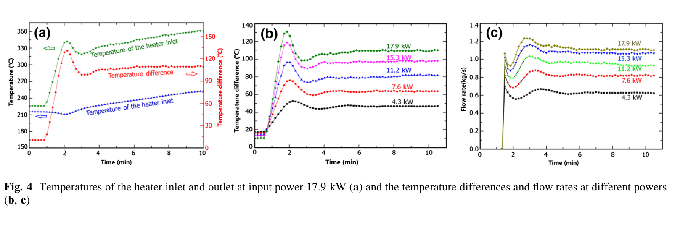

# 从 Yue 同篇功率序列做一次条件留出：低功率点暴露热路闭合缺口

**2026-11-03。** 在第十二轮[复核](kylin-v12-review-20261103.md)之后，改选 [Yue 2017 原文](yue-2017-kylin-original-20261103.pdf) PDF 第 5 页 §5.1/Fig.4 的**同一实验序列**。§5.1 明说五个功率工况的二次油流条件保持相同；第 6 页 §5.2 给 17.9 kW 的实验主流量 `1.12 kg/s`。这比 Li 24 kW 与 Yue 17.9 kW 的跨论文拼接少一层油侧差异。阀位仍未逐点记录，主流量仍由加热段输入功率及进出口温差反算，故以下只检验**声明闭合下的功率趋势**。

## 选用了什么，依据是什么

**选用 17.9 kW 作单点锚、其余四个功率作未参与标定的图读对照。** 从 Fig.4(c) 的约 8–10 min 平台目视取 `ṁ≈0.62/0.82/0.94/1.06 kg/s`，分别对应 `4.3/7.6/11.2/15.3 kW`；`17.9 kW,1.12 kg/s` 用 §5.2 文字直给值。图读值仅精确到约百分位，`±0.03 kg/s` 只是**人为设置的图读扰动情景**，不是实验误差条。前向参照关系取

`ṁ(P)=1.12×(P/17.9)^(1/3)`，

它同时假定总阻力 `K`、净热份额 `η`、有效高度 `H` 和物性组合 `C=c_p/(2βρ²gA²)` 在该序列中不变；只要任何一个量变，该曲线就会移动。因此它是**固定闭合的零假设**，不是完整四段模型的无条件预言。

### Yue Fig.4(a–c) 原始图像

图 (c) 平台读数与图 (b) 共用加热段功率平衡信息，不构成彼此独立的两个 FoM 验证。原图 §5.1 只说明二次油流“kept at the same conditions”；**没有逐点给阀位、净热或测量协方差**。

## 可复核结果

| 功率 kW | 主流量 kg/s | 固定闭合预测 kg/s | 图读−预测 kg/s | `(P/ṁ³)/(P₁₇.₉/ṁ₁₇.₉³)` |
|---:|---:|---:|---:|---:|
| 4.3 | 约 0.62 | 0.696 | −0.076 | 约 1.416 |
| 7.6 | 约 0.82 | 0.842 | −0.022 | 约 1.082 |
| 11.2 | 约 0.94 | 0.958 | −0.018 | 约 1.058 |
| 15.3 | 约 1.06 | 1.063 | −0.003 | 约 1.008 |
| 17.9 | **1.12，§5.2 直给** | **1.120，标定锚** | 0 | 1 |

[复算脚本](kylin-same-paper-trend-20261103.py)、[CSV](kylin-same-paper-trend-20261103.csv)和[输出](kylin-same-paper-trend-20261103.txt)均保留未四舍五入的中间计算。4.3 kW 的图读残差约 `−0.076 kg/s`；即使只为测试图读敏感性而把该图读值上移 `0.03`，仍与固定闭合曲线差 `0.046 kg/s`。若 17.9 kW 也完全按 Fig.4(c) 平台约读 `1.10` 而不用 §5.2 的 `1.12`，差仍约 `0.034 kg/s`。这两项**不是统计显著性或仪表不确定度**，只表明差值不容易由这一档图读舍入消去。

等价地，在 `K,C,H` 不变的**反事实**下，4.3 kW 的 `η₄.₃/η₁₇.₉≈1/1.416≈0.706`。这不是低功率实测热效率；`K`、物性和浮升温度场都能承担同一代理变化。该趋势与 Yue 第 6 页 §5.2 对散热和阀门模拟缺失的讨论、Li 2015 第 5 页 §3.3.1 对低功率散热的讨论**方向相容**，却不能单独识别哪一种机制。

## 对论文逻辑的推进

1. **有了一个更小的内部检查点**：同文献五功率、油侧同设定，比跨论文 24→17.9 kW 更适合先做趋势检查。高功率 15.3 kW 与固定闭合近似重合，4.3 kW 明显偏离，这给“热损/阻力/物性随功率变化”提供一个需解释的现象。
2. **只能拒绝联合固定闭合，不能单独拒绝恒 `K`**：`P/ṁ³` 的变化同时受 `K、η、H、C` 控制，且流量由功率平衡反算。将低功率偏差直接归给阀位或 `K_i(Re)` 会重复前轮归因错误。
3. **留出验证仍缺门槛信息**：若要把 4.3 kW 升为物理模型留出点，须有该实验序列的逐点阀位、油侧入口温度、加热段净热/散热、主流量计算式和误差协方差。若拿不到，只能把它写成“同篇实验曲线对简单三次方律的条件趋势诊断”。

**下一步最小可执行动作**：把 4.3 kW 与 17.9 kW 的加热段进出口温度、加热器电功率、二次油进出口温度及流量、阀位记录补到[工况台账](kylin-v12-reviewed-condition-ledger-20261103.csv)；最好增加经校准的直接主流量。**单纯重算 `ṁc_pΔT_HS` 没有独立检验力**，因为论文的 `ṁ` 本来就由这条能量平衡求出。需用独立的油侧量热、外表热损测量或直接流量，才能检验热账并区分 `η(P)` 与 `K(P)`；再将温度依赖物性纳入前向模型。成对台架的 `δ` 仍需原型/台架两侧同口径阻力资料，本单侧曲线填不了那一格。

分析采用 norman-paper-reading 技能｜作者：N同学｜小红书：N同学｜B站/抖音：耐心的N同学
Analysis performed using the norman-paper-reading skill | Author: N同学 | Xiaohongshu: N同学 | Bilibili/Douyin: 耐心的N同学
