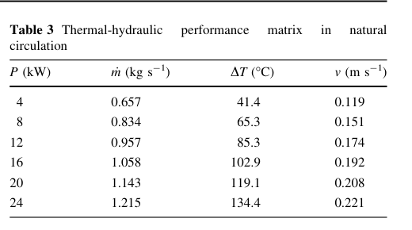
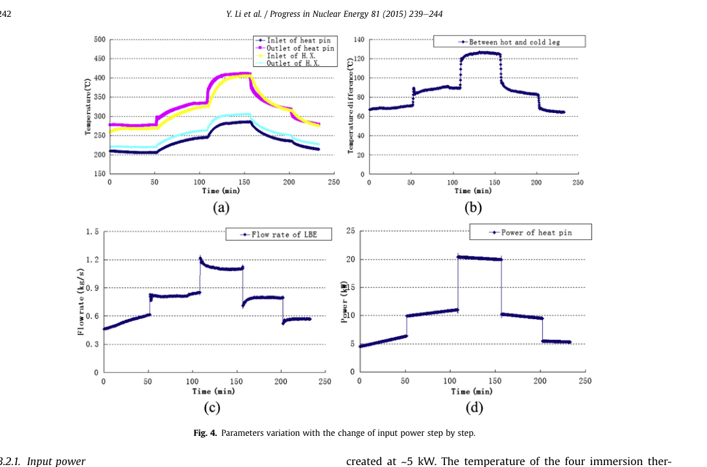

# KYLIN 单侧闭合复核：表内一致性成立，阀位归因与判别力须重做

**2026-11-03。** 选用 Workbuddy 的[第十一轮报告](kylin-v11-upload-report-20261103.html)、[脚本](kylin-v11-upload-20261103.py)与[379 行日志](kylin-v11-upload-log-20261103.txt)，对照 [Yue 2017 原文](yue-2017-kylin-original-20261103.pdf)、[Li 2015 原文](li-2015-kylin-original-20261103.pdf)、[Xu FR26 原文](xu-fr26-170-original-20261102.pdf)及上轮[逐构件复核](component-re-v2-review-20261103.md)。上传脚本隔离重跑 **379 行逐行一致**；[独立复算脚本](kylin-v11-independent-audit-20261103.py)和[结果](kylin-v11-independent-audit-20261103.txt)重新算了六点反解和 17.9 kW 自洽根。数值复现与物理归因分开判断。

## 选用了什么，依据是什么

用 **Yue Table 2/3 的同文闭合检查**，再用 **Li Fig. 4 与 §3.3 的实验控制体检查**。Yue 式(5)将热驱动、回路总阻力和质量流量联系起来；关键是区分**作者理论表**、**加热段温升**、**热腿与冷腿温差**、**实验流量的热平衡反算**。除这四者口径对齐外，不能把拟合的等效阻力变化归给阀门或逐构件 `K(Re)`。

### Yue Table 3：六点是作者理论矩阵

{width=62%}

按 Yue 式(5)、Table 2 插值的 `K(m)`，并采用 v11 声明的 **Xu 物性斜率** `ρβ=1.3235 kg/(m³·K)`、固定 `ρ=10370 kg/m³`、由同一 Table 3 反解的 `c_p≈146.97 J/(kg·K)`，独立复算的六行 `H_eff` 为 **3.2875、3.3179、3.3072、3.3226、3.3270、3.3093 m**，均值 **3.3119 m**。v11 的算术成立；`±0.0197 m` 是六行**半极差**，不是测量不确定度。

Xu PDF 第 4 页 Table 1 给加热与冷却段之间的高度 **3.35 m**，二者差约 **1.14%**。这是一项有用的**跨文献几何一致性检查**，但不是“两篇独立实验互证”：Xu 正文明说其 Prototype loop 1 几何与 **KYLIN-II** 一致；而 `H_eff` 又用 Yue 自己的 Table 2/3 和外加的 Xu 物性反解。六点正向复算在约 ±0.25% 内也主要是同一理论表的回代。

### Yue Table 2：阻力分解可直读，沿程关联式仍缺

Yue PDF 第 3 页式(6)–(9)、第 4 页 Table 2 原文给 `K_pipe=f L_pipe/D+1`；`L_pipe≈11 m` 被作者称作 **conservatively assumed**。若按这个假设反解，五点隐含 `f=0.04278→0.03947`，对 Re 的表内对数斜率约 **−0.04865**；在 Re=27800 处，隐含 Darcy `f=0.03947`，光滑管 Blasius 为 `0.02450`。这组数值得保留，但它**不能唯一识别作者究竟用了哪条摩擦关联式**。表格只保留一位小数，而且有效长度、粗糙度、弯头份额、流态及物性参考温度都未闭合。

来源定级要分对象：**Yue Table 2 的原始理论数是 L1 原文直读**；`f` 与表内指数是对 `11 m` 等声明的**条件反算**，既不是作者给出的关联式，也不是 L3“实测标定”。用该表插值可以复现作者口径，不能叫独立验证。v11 以不同物性公式倒推 `ρ、μ` 得到不同“参考温度”，只能说明现有公式不能重建表格；不能据此断定作者必用了第三套物性。

v11 进一步把 `K_HS−4.346f_Blasius` 的下降归给弯头/三通 `K(Re)`，证据不足。Yue 式(7)没有给出口损失 `K_out=0.50`，这是 v11 自取的闭合；其低端 `Re_HS≈1900` 处还直接套用了湍流 Blasius。剩余项因此混合了未定的出口损失、过渡流、摩擦和表格取整。**逐构件局阻随 Re 变化仍是待检验假设，不能据此给 `δ` 定域。**

v11 在识别设计中又把台架温度取到 **300 K** 来制造 `Δf=0.256`，据此给出“最好 `σ_B/B=28%`、现实 114%”。但 Li/Yue 的设施运行温区下限为 **150 °C（423 K）**，300 K 不属于所研究的液态运行域；所用 `σ_D=.5/2%` 也没有本装置的量测与协方差依据。作为更贴近设施温区的**条件算术**，仍固定脚本的原型 750 K 与其他输入，只让台架在 **423.15→500 K** 变化，则 `Δf≈0.0762`，同样假设 `σ_D=.5 pp` 时 `σ_B/B≈95.5%`；这仍不是实际仪表精度或可执行的成对试验方案。`f=(r_m d μ_R)^n` 虽没有显式功率，`r_m` 和 `μ_R` 都可能随功率变；正确说法是**功率跨度不保证 `f` 分离**，须从真实成对工况检查，而非宣布“功率扫描绝不提供信息”或“流量 FoM 识别路线应放弃”。

## 24→17.9 kW：情景外推能算，比较条件尚未对齐

Li PDF 第 5 页 §3.3 在 **24 kW、最大阀门开度、二次油约 1.0 kg/s** 报 `1.21 kg/s`；Yue PDF 第 6 页 §5.2 在 **17.9 kW** 报实验 `1.12 kg/s`，但两侧阀位、油侧与热损口径未证相同。实验流量还按加热段热平衡估计（Li PDF 第 2 页 §2；Yue PDF 第 5 页 §5.1）。下面是**以前者定一个 24 kW 水平、只改变阻力斜率**的条件情景，不称留出验证：

| 阻力假设 | 17.9 kW 自洽求根 `m` | 相对 Yue `1.12` |
|---|---:|---:|
| `K` 恒定 | `1.097318 kg/s` | `−2.03%` |
| 管段等效正指数 `0.05` | `1.095991 kg/s` | `−2.14%` |
| 管段等效正指数 `0.25` | `1.090333 kg/s` | `−2.65%` |

v11 的“`m=0.05`”行实际传入了回归**带符号斜率** `b=−0.048651`，相当于用**负指数**，并只作一次近似更新；它报 `1.0986 kg/s`。改为正指数并联立求根后，`0.05` 与 `0.25` 两情景相差 **0.005658 kg/s**，约为 1.1 kg/s 的 **0.52%**，不是 v11 的 `0.0078 kg/s / 0.7%`。这种小差别提示需要核量测精度；**文中未给可用的热电偶等级、流量综合误差或协方差**，不能宣布“差测量误差两倍、做不到区分”。v11 取 `±1.5 K`、比热范围 `145–149` 及合成 `σ_D=2%` 都尚无同工况仪表或关联式有效域出处，应留作 L4 情景。

从恒 `K` 情景的 `1.097318` 升到 `1.12 kg/s`，若其他量固定，精确所需的是 **`K` 乘 0.94047（−5.95%）**，或净热量/有效高度乘 **1.06330（+6.33%）**。v11 用微分近似把三者都称“6.2%”，量级可用于探索，不能叫已证实的缺口来源。将 `H_eff≈3.312 m` 的表内半极差当真实不确定度，或把两文控制体未核直接视作“合理范围”，都没有依据。

## Li Fig. 4 的控制体：撤回“阻力变化 2.95 倍由阀位造成”

{width=95%}

Fig. 4(b) 的纵轴明确写 **“Between hot and cold leg”**。v11 把该图约 `68/89/125 K` 与 Fig. 4(c) 的约 `0.5/0.8/1.1 kg/s` 相乘，令 `P=mc_pΔT`，把**热腿—冷腿温差**当作**加热段进出口温升**。Fig. 4(a) 直接画了加热段入口/出口温度，说明这是两个不同控制体。三个乘积恰好约 `5/10.5/20.2 kW`，与 Fig. 4(d) 的约 `5/10/20 kW` 相近；**数值巧合不能证明热路无损或控制体等同**。第四个 `24 kW,1.21 kg/s` 点来自另一节 §3.3，v11 又将 Yue **理论** Table 3 的 `134.4 K` 混入，不能称“Li 四点实测 log-log 回归”。

若仅用 Fig. 4(d) 所画电功率与 Fig. 4(c) 约读流量，条件量 `P/m³` 从低到高确实可相差约三倍；它是**加热电功率、净热、浮升高度、物性与总阻力共同作用的合成代理**，不是局部阻力系数 `K` 的实测变化。Li 正文只说 24 kW 最大点同时在最大阀位，未给 Fig. 4 扫描各点阀位。因而“记录并固定阀位”是正确的下一步要求；“2.95 倍最可能由阀位造成”“数据已否定恒 `K`”均需撤回。Li 也明确指出低功率散热影响不可忽略（PDF 第 5 页 §3.3.1），它是现成的竞争解释。

## 对参数域与下一轮实验的实际推进

1. **KYLIN 单侧理论闭合有了精确限度：** Yue Table 2/3 在声明物性下可重建，不能从中分出具体 `K_i(Re)`；`H_eff` 与 Xu 几何相近是来源相关的交叉一致性。
2. **17.9 kW 目前是条件情景对照：** 同一阀位、二次油条件、加热段净热和误差资料未对齐，不能报成验证；斜率情景的分辨量修正为约 **0.0057 kg/s**。
3. **最小新数据清单：** 已把两文现有点和空格落成[工况台账 CSV](kylin-condition-ledger-20261103.csv)。同一固定阀位下记录加热棒电功率、加热段进出口与冷热腿四处温度、油流量/入口温度、独立或可校核的主流量及其不确定度，最好加逐段压差。再选较大功率跨度并测热损；低功率处必须控制散热。这样才有资格做单侧关联式判别与成对参数域。
4. **GSA 入口：** 当前可做有标签的**情景灵敏度**；概率 GSA 仍需几何、热路、阀位和阻力的联合有来源域。FoM 中流量与由同一加热段热平衡反算的温升须按相关量处理。

本报告核对的是脚本和已上传原文的**稳态、名义模型**。图中未标的点只作约读，不给出虚假的小数精度；`H_eff` 半极差、回归残差和设定的 `σ_D` 均不代表实物测量不确定度。对应状态更新见[论点—证据矩阵](../paper-workspace/claim-matrix.md)。

分析采用 norman-paper-reading 技能｜作者：N同学｜小红书：N同学｜B站/抖音：耐心的N同学
Analysis performed using the norman-paper-reading skill | Author: N同学 | Xiaohongshu: N同学 | Bilibili/Douyin: 耐心的N同学
