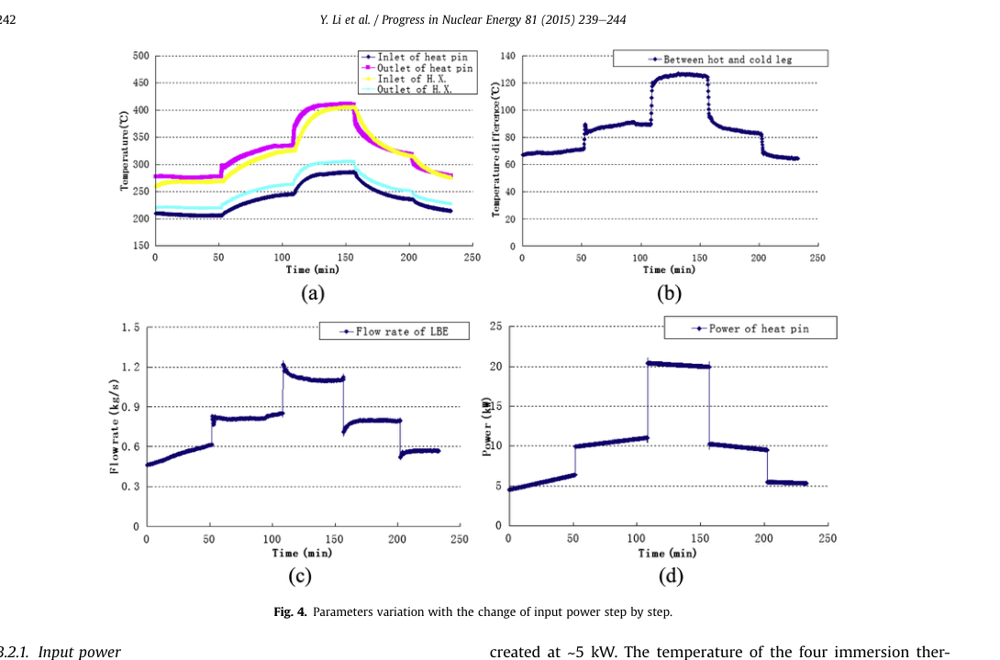

# KYLIN 第十二轮复核：口径分级保留，条件代理和判别门槛收窄

**2026-11-03。** 选用 Workbuddy 第十二轮[报告](kylin-v12-upload-report-20261103.html)、[脚本](kylin-v12-upload-20261103.py)、[日志](kylin-v12-upload-log-20261103.txt)、[参数溯源表](kylin-v12-upload-provenance-20261103.md)与[工况台账](kylin-v12-upload-ledger-20261103.csv)；依据是 [Li 2015 原文](li-2015-kylin-original-20261103.pdf) PDF 第 2、4–5 页、[Yue 2017 原文](yue-2017-kylin-original-20261103.pdf) PDF 第 3–6 页和 [Xu FR26 原文](xu-fr26-170-original-20261102.pdf) PDF 第 4 页。将上传脚本与既有 `source_free_bound_v5.py` 隔离运行后，**271 行日志的文字与数值逐行相同**（忽略行尾填充空格及换行符）。[独立算术脚本](kylin-v12-independent-audit-20261103.py)及[输出](kylin-v12-independent-audit-20261103.txt)另核了比值、判别尺度和模型份额差。原文图像已目视重查；数值复现只证明脚本可运行，以下分别判定解释是否得到来源支持。

## 选用了什么，依据是什么

采用三层审查：**原文控制体**、**方程量纲和量词**、**判别规则的统计含义**。Li §2 说明主流量由加热段功率平衡获得，Fig.4(b) 标题是冷热腿温差；因此流量与温度存在共同输入，不能把图上功率—流量代理视作独立的机械阻力测量。Yue Table 2/3 是作者理论计算，按已声明的 `L_pipe≈11 m` 反算摩擦因子属于“原文数＋条件反算”。17.9 kW 实验值与 Li 的 24 kW 最大点缺跨文献阀位、二次侧及净热对齐信息。

## 已成立的修订

1. **有效浮升高度**：六行反解 `3.2875–3.3270 m`、半极差 `0.0197 m` 与 Xu 所列 `3.35 m` 是同一 KYLIN 几何的跨文献**一致性检查**；半极差不是实物不确定度，也不是独立实验验证。
2. **正指数求根**：固定 24 kW 水平后，17.9 kW 的 `K` 恒定、指数 `0.05`、指数 `0.25` 条件根分别为 `1.097318 / 1.095992 / 1.090340 kg/s`。原 v11 的负指数和一次近似分支作废；两指数分支只差 `0.005652 kg/s`。数字与 v11 独立复算的 `0.005658` 差约 `6×10⁻⁶ kg/s`，源于插值规则。
3. **Li 温差控制体**：Fig.4(b) 的 `68/89/125 K` 是冷热腿温差，不可放进加热段的 `P=ṁc_pΔT_HS`。由此反解的“`K` 变 `2.95` 倍并由阀位主导”撤回。
4. **输入定级**：L1 原文值、L1c 原文值加**明确声明的条件反算**、L2 有适用域的关联式、L3 对实测标定、L4 自设情景，这五档可用。Yue Table 2 原始阻力值是“原文的**理论计算值**”L1；`f≈0.03947–0.04278` 与斜率 `0.0487` 是依赖 `L_pipe≈11 m` 的 L1c，不能归成作者原关联式或实验测定。
5. **热路与误差**：`300 K` 的台架试算低于该设施所列 `150°C` 运行下限。`423.15→500 K`、原型 `750 K`、`σ_D=0.5 pp` 的指定情景算得 `Δf≈0.07623`、`σ_B/B≈95.5%`；`σ_D` 没有同工况误差链出处，结论只属于该温度对和该误差假设。功率变化可能改变流量比和黏度比，故“功率扫描绝不提供信息”也已撤回。
6. **构件归因**：Yue Table 2 的 `K_HS` 随所列 Re 从 `2.9` 到 `2.6`；扣除采用 `K_out=0.5` 和 Blasius 的情景摩擦项之后，剩余量下降不能证明弯头/三通的 `K_i(Re)`，更不能界定成对 `δ`。低端 Re 约 1900，跨入过渡区，局部项及原表舍入都未独立分离。

### Li Fig.4 的原始图像

Li PDF 第 4 页 §3.2.1 正文给主流量 `0.5/0.8/1.1 kg/s` 和固定油流量 `1.02 kg/s`；功率 `~5/~10/~20 kW` 是图 (d) 约读。该实验报告的主流量按加热段功率平衡反算（PDF 第 2 页 §2），所以图 (c) 不能作为与电功率独立的流量计记录。

## 需要继续收窄的三项

### 1. `P/ṁ³=2.662` 是条件代理，不能直接给热损份额

用图读 `P_5≈5 kW, P_{20}≈20 kW` 及正文 `ṁ_5≈0.5, ṁ_{20}≈1.1 kg/s`，得到

`R = (P_5/ṁ_5³)/(P_{20}/ṁ_{20}³) = 2.662`。

从 v12 声明的集总关系 `ṁ³ = 2βρ²gH A² ηP/(c_p K)`，精确的**模型内**跨工况关系是

`R = (C_5/C_{20}) (K_5/K_{20}) (H_{20}/H_5) (η_{20}/η_5)`，其中 `C=c_p/(2βρ²gA²)`。

所以“只由 `K/(ηH)` 决定”还需声明 `C_5=C_{20}`；同一几何只能约掉 `A`，不能自动约掉随温度变化的 `ρ、β、c_p`。**再假定** `K、H、C` 均不变，才有 `η_5/η_{20}=1/2.662=0.375657`。这只是**两个净热份额的比**：若 `η_{20}=0.8`，则 `η_5≈0.301`；即使 `η_{20}≤1`，也只能给该模型中的 `η_5≤0.376`，不能宣布实物“恰有 38% 进入工质”。Li 第 5 页 §3.3.1 的低功率散热讨论支持方向，**不提供这个热损百分数**。

`2.662` 也没有可引用的三位有效数字精度：两个功率是图读，流量只报告到一位小数。仅作说明，固定功率比、让两流量各浮动 `±0.05 kg/s`，代理范围就是 `1.739–4.172`；这**不是**文献给出的误差界。由于主流量用功率平衡反算，`P` 与 `ṁ` 的误差还相关。正文只宜写“**约数倍**的 `P/ṁ³` 合成代理变化”，并列出读图和口径条件；不能用它证明 `K`、阀位或 `η` 的变化幅度。

### 2. `0.002826 kg/s` 是指定半差规则，不是留出验证门槛

两条件预测 `1.095992` 与 `1.090340 kg/s` 相距 `0.005652 kg/s`；半差 `0.002826 kg/s`（约 `0.257%`）算术正确。它来自“以两个**精确已知**预测的中点分类，要求观测标准差不超过半差”的**示例规则**。若改成“两个 `±1.96σ` 区间不重叠”的理想化 95% 可视区分规则，则需 `σ<0.001442 kg/s`；这两种规则本身不同，且都未包含模型参数误差、共同偏差及热平衡反算的相关误差。

更直接的是，Yue 实验 `1.12 kg/s` 比两预测分别高 `0.024008` 和 `0.029660 kg/s`，**两模型都在观测同一侧**，且共同偏差比模型间距大约 4–5 倍。在阀位、油侧与净热仍不对齐时，即使把单次流量读数测到 `0.26%`，也无法把这段差值归因于摩擦指数。独立流量计会提供有价值的交叉校核；**它不是逻辑上唯一的测量方式**：经独立热量标定、明确协方差和足够小的总不确定度，能量平衡流量也可以用于单一 FoM 检验。若同时声称流量和同控制体温升是两个独立验证 FoM，则必须处理它们的共同计算来源。

### 3. 留出工况要记录输入差异，未必强迫数值相等

v12 的四类缺口——阀位、二次侧、控制体/净热、误差链——分类正确，但“阀位与油流量必须相同，四门全过才有资格称留出点”过死。若两次设定不同，只要**记录数值并把差异作为前向模型的输入**，仍可构成留出检验；若输入未知，才只能称跨文献条件外推。指数判别另外需要事先选判别统计量和纳入模型不确定度，不能把流量 `σ≤0.002826` 填作一切留出点的统一验收标准。[修订工况台账](kylin-v12-reviewed-condition-ledger-20261103.csv)保留六行原记录，并另加 `review_note` 和相应条件。

## 一处旧账的准确量级

Yue Table 2 理论闭合下的沿程份额 `73.2–73.9%` 与四段模型在另一口径下反标定的 `48.67%`，名义差 `24.53–25.23` 个百分点，倍率 `1.50–1.52`，**不是“差一个数量级”**。因为前者是理论 `K_pipe−1` 的份额，后者是单点标定并依赖其他阻力/热路定义，尚未对齐参考动压、局阻、阀位与总热量。把这组差异当作**需重建口径的诊断**，不要称同工况物理矛盾，也不要选其中一个当实测真值。

还有一处撤回理由要写准确：v11 所报斜率 `0.563` 是代码中直接用 `log(1.21/0.5)/log(24/5)` 计算，**这一行未用 Yue 的 `134.4 K`**；但它把 Li Fig.4 的约读点与另一节的 24 kW 最大点合并，未证同阀位、油侧和热损，因此不能证伪恒 `K`。Yue 理论 `134.4 K` 是 v11 随后反算 `K` 的另一处混用。两处错误均要撤回，不能把原因混成一个。

## 论文目前可写什么、下一步怎么推进

**可写的最小主张**：给定四段模型、热路/阻力闭合及**有来源的输入域**，设计阶段可用 FoM 方程求比例失真的条件界；`P/ṁ³`、Yue 理论阻力和 Li 实验点只负责口径审计与模型诊断，当前不支撑实物 `δ` 范围或“≤3%”保证。摄动负责局部梯度与测量需求排序；GSA 待输入域来源和变量相关性建立后再做全域贡献排序；认证区间单独负责最大偏差包络。不要用 GSA 的方差贡献代替最坏界。

**最小下一步**：① 用同一设施的原始工况记录补 24/17.9 kW 的阀位、二次油温度与流量、加热段电功率/净热、主流量算法及不确定度；② 若这些资料拿不到，改选同篇明确同阀位的多功率序列作**条件趋势检验**，保留读图误差；③ 对成对缩比论证单独索取原型/台架净流道、逐段压差和阀件开度，形成 `d,w,δ` 的来源台账；④ 在已有来源域内跑摄动、GSA，并给出闭合敏感的条件区间界。当前两篇单侧实验不能填成对 `δ`。

**未解决**：Li Fig.4 读图误差与热平衡流量协方差未给；两文未证 24/17.9 kW 输入完全可比；Yue 理论 `f` 的原关联式、成对局阻与 Zhao 净流道仍空。这里的数值小数是模型/图读算术，不是测量精度。

分析采用 norman-paper-reading 技能｜作者：N同学｜小红书：N同学｜B站/抖音：耐心的N同学
Analysis performed using the norman-paper-reading skill | Author: N同学 | Xiaohongshu: N同学 | Bilibili/Douyin: 耐心的N同学
