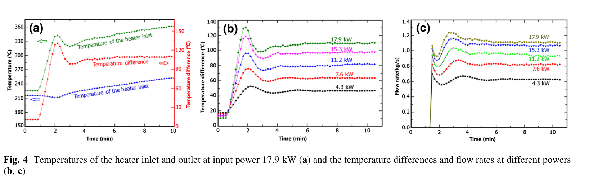

# KYLIN v13 复核：热损拟合成立，物理判据仍缺同口径测量

**2026-11-03。** 选用 Workbuddy 的[第十三轮 HTML](kylin-v13-upload-report-20261103.html)、[脚本](kylin-v13-upload-20261103.py)、[日志](kylin-v13-upload-log-20261103.txt)、[参数表](kylin-v13-upload-provenance-20261103.md)，并核对 [Yue 2017 原文](yue-2017-kylin-original-20261103.pdf) PDF 第 3–6 页、[Xu FR26 原文](xu-fr26-170-original-20261102.pdf) PDF 第 4 页和[前轮同篇趋势检查](kylin-same-paper-trend-review-20261103.md)。上传脚本隔离运行的 **241 行文字与数值逐行相同**（忽略行尾填充空格和换行符）。[独立复算脚本](kylin-v13-independent-audit-20261103.py)及[输出](kylin-v13-independent-audit-20261103.txt)另核公式、绝对水平、图读和留一功率检验。

## 选用了什么，依据是什么

把问题分成三层：**功率—流量曲线能否拟合**、拟合的 `L` 能否等同实测热损、以及一个热损读数能否判定局阻机制。Yue §5.1 写明主流量由加热段输入功率和进出口温差按能量平衡反算；Table 2 是理论阻力表，Fig.4(b,c) 是同一试验序列的温差与流量图。因此，拟合残差可作条件趋势诊断；将其升为物理热损或实物局阻上界，还需要额外的控制体和独立量。

### Yue Fig.4(a–c) 原始图像

图 (a) **只画 17.9 kW** 的加热段进出口温度；图 (b,c) 画五功率的温差、流量。v13 用 `483/633 K` 作为“低/高功率温度”不符合图 (a) 的位置含义：它们是**同一 17.9 kW 工况中两处温度的量级**。

## 算术可保留，归因需要修正

| v13 数值 | 本轮判定 | 可写边界 |
|---|---|---|
| 4.3 kW 固定闭合 `0.696236`、图读 `~0.62 kg/s` | 复现 | 四个低功率流量是图读值；低功率有联合闭合缺口 |
| 让 Yue Table 2 的理论 `K(ṁ)` 参与后预测 `0.687989 kg/s` | 复现 | 只在该**理论阻力表**和插值规则下缩小约 10.8% 的流量缺口 |
| 一个参数、五点最小二乘 `L≈1.250 kW`，最大相对残差约 1.84% | 复现 | 是**相对锚点归一化的曲线偏移参数**；不是测得的表面热损，也不是完整模型验证 |
| `C(483)/C(633)≈1.001497` | 复现 | 是 Xu 物性式的条件模型数，不能称两个功率点的实测物性比 |
| `K` 表内等效指数 `0.068`，单独覆盖需约 `0.588` | 条件算术 | 实物阀位、局阻和 Re 依赖未知，不能给 `K` 的物理上限 |

## 关键修正一：`H` 放错了位置

从 v13 自己写的动量式 `ρgβHΔT=Kṁ²/(2ρA²)` 与能量式 `ΔT=P_net/(ṁc_p)` 消去温差，正确得到

`ṁ³ = H·P_net/(C·K)`，`C=c_p/(2βρ²gA²)`。

v13 脚本第 57 行和第 G 段写成 `ṁ³=P_net/(KCH)`，把 `H` 放在分母；其 `dlnṁ` 中的 `−dlnH` 也随之错。**同一装置比较功率时 `H` 常数约掉，故 `L≈1.25` 的相对拟合数字未受这个符号错误影响**；高度归因则全部受影响。对 `R=(P₄.₃/ṁ₄.₃³)/(P₁₇.₉/ṁ₁₇.₉³)=1.4161`，若只让有效高度变化、其他量固定，需 `H₄.₃=H₁₇.₉/R≈3.3119/1.4161=2.339 m`，**不是 4.69 m**。

几何中心高差不变可以在特定集总温度场模型内**规定** `H` 恒定；真实闭合回路的等效浮升因温度沿程分布而变，现有理论表的 `3.3119 m` 及六行半极差不能作为低功率实物高度的测量界。v13 的“高度必为零份额”“4.69 m 超几何而排除”应撤回，改称“若模型固定有效高度，则该机制按定义不参与”。

## 关键修正二：`0.77` 是情景指数，不是局阻上界

把 `K_pipe−1∝Re^(−0.25)`、**全部**局阻 `K_local∝Re^(−0.77)` 当作两个外推函数，确可算出约 63% 的对数缺口由阻力承担；`0.66 kW` 也可作为该**特定外推情景**的单点曲线偏移值。来源 [Al‑Tameemi–Ricco 上传原稿](altameemi-ricco-mitre-original-20261103.pdf)的 `0.77` 是水/空气、锐角斜接 90° 弯头拟合式中**随 Re 变化的一项**的幂次，原式还有 `+0.9`；它没有给 KYLIN 的阀门、三通、弯头混合局阻一个上界。黏度与构件开度也不由 `ṁ` 比独自决定。

若固定热路、物性和有效高度，单由阻力解释图读比值，需要 `K₄.₃/K₁₇.₉=1.4161`；以 v13 Table 2 插值得 `K₁₇.₉=23.06`，则需 `K₄.₃≈32.66`，相当于该流量区间的等效指数约 `0.588`。**现有理论表只给 `24.008`，说明作者这张表的阻力律不足以单独覆盖图读趋势；但它没有证明实物局阻不可能达到 `32.66`。**未记录阀位时，更不能宣布“阻力至多 63%、热账至少 37%”。这两百分数只保留为注明所选指数的情景分账。

Xu 物性式下，数值扫描设施列出的 `423.15–773.15 K` 得 `C_max/C_min≈1.00219`，因此**在这套物性式和温区内**，`C` 的变化确实很小。这个计算比把图 (a) 的两个测点误当成两个功率工况更稳；它仍不是对所有物性版本或实验物性误差的证明。

## 关键修正三：拟合 `L` 与“加热段表面热损”并非同一个量

v13 以 17.9 kW、`1.12 kg/s` 作锚，每个功率用 `(P−L)/(17.9−L)` 预测流量。该比值法**重新标定了绝对 `C·K/H` 水平**。若按 v13 选用的 Xu 物性 `T=500 K`、Yue 理论阻力 `K(1.12)=23.06`、`H=3.3119 m` 和主管内径 `26 mm` 直接代回绝对式，要产生 `1.12 kg/s`，需要 `P_net≈18.751 kW`。这比所报加热输入 `17.9 kW` 高约 `0.851 kW`；若要同时让 `L=1.25 kW` 表示电输入外漏，理论阻力须降至约 `20.48`（现取 `23.06`），或改动等效高度/控制体。**不能一面保留上述理论常数的绝对口径，一面把相对曲线拟合的 `+1.25 kW` 称为已闭合的物理漏热。** 这是一处模型口径诊断，并未证明实验有负热损：作者理论表、实验反算流量与 Xu 物性并非同一标定对象。

更要紧的是 Yue §5.1 的流量口径。若文中的 `ṁ_report=P_electric/(c_pΔT_HS)` 按字面使用，而 `L_HS` 真是**加热段外表漏热**，则真实主流量应为 `ṁ_true=(P_electric−L_HS)/(c_pΔT_HS)=ηṁ_report`。例如 `L_HS=1.25 kW` 时，4.3/17.9 kW 的图上 `0.62/1.12` 将分别对应 `0.440/1.042 kg/s` 的条件真实值，须重新做前向比较；不能继续把原图流量当作未受漏热影响的独立测量。固定 `K,C,H` 时，`ṁ_true∝(ηP)^(1/3)`，从而 `ṁ_report∝P^(1/3)η^(−2/3)`：低功率 `η` 更低会使**报告流量相对三次方律偏高**，与当前图读的偏低方向相反。故正的加热段外漏**不能直接**解释图 (c) 的低功率缺口；`L` 可能只是沿程热损、温度场、阻力与流量反算口径的合成偏移。若作者用于反算的“输入功率”已经是独立校正过的净热，以上条件反例需相应重算；原文未给可核的完整热账。

测加热段外表热流很有价值，但**测到 `0.66/1.38 kW` 中任一侧也不足以作 v13 的三分支裁决**：阈值来自一张理论阻力表、图读流量、假设的局阻指数和恒定 `L`，且仪表测的是特定表面的热损，曲线拟合的是全回路等效偏移。要把它们比较，必须先对齐热损控制体，并重新计算流量和阻力。

## 一个新增的实际检验：留一功率再拟合

v13 把五点全部用于 `L` 的最小二乘，残差小**不必然**，但也不是留出验证。固定 17.9 kW 锚点，每次只用其余三个图读低功率点拟合 `L`，预测未参与拟合的第四点（沿用 v13 的 Table 2 线性插值）：

| 留出的功率 | 其余点拟合 `L` kW | 留出预测 kg/s | 图读 kg/s | 预测−图读 kg/s |
|---:|---:|---:|---:|---:|
| 4.3 | 0.745 | 0.654 | 约 0.62 | **+0.034** |
| 7.6 | 1.367 | 0.802 | 约 0.82 | −0.018 |
| 11.2 | 1.255 | 0.938 | 约 0.94 | −0.002 |
| 15.3 | 1.254 | 1.056 | 约 1.06 | −0.004 |

最低功率点一旦不参与拟合，`L` 从全点 `1.250` 降到 `0.745 kW`，留出残差 `0.034 kg/s`，略超前轮自设的 `±0.03 kg/s` **图读敏感性情景**。这表明单参数曲线主要受最低点约束；**也不能据 0.004 kg/s 的超出宣布统计拒绝**，因为该 ±0.03 并非实验误差界，且同一序列的报告流量与温差共源。

v13 用 Fig.4(b) 读的 `58 K`（7.6 kW）和 `72 K`（11.2 kW）明显低于原图平台，原图目视更接近 `~63 K`、`~80 K`。按 `46/63/80/97/108.6 K` 作一组**另行声明的图读情景**，`ṁc_pΔT/P` 约为 `0.971/0.995/0.983/0.984/0.995`；v13 所谓“系统性 6–11% 自洽缺口”不能当作实验误差估计。这组乘积仍只是作者流量反算式的回代，不是第二个独立验证量。

## 修订后的可发表表述与下一步

**可写：** 在 Yue 同篇五功率图读与 Table 2 理论阻力的指定口径下，一项恒定的**等效功率偏移** `L_fit≈1.25 kW` 可使五点拟合残差约在 1.84% 内；Xu 物性组合在所扫描设施温区内变化很小。留一低功率点检验显示该偏移对最低点较敏感。该结果提供一个**需测量来区分的热路/阻力混合假设**，不是独立的热损识别，也不是 `δ` 的有来源边界。

**最小下一步应同时取得两类量**：① 与流量反算**独立**的主流量或加热段真实入流体热量（如校准热流计和加热段分段热平衡）；② 同功率、同阀位定义下的阀门开度与逐段压差，以定回路实际 `K(P)`。油侧进出口焓差可约束总热去向，还须区分加热段、冷热腿及换热器的控制体。至少两个功率点测外漏，才能检验 `L(P)=常数`；一个 `1 kW` 读数不能裁定三种机制。保持单侧诊断与 Zhao 成对 `δ` 参数域分开：KYLIN 的五功率曲线不能提供原型/台架两侧局阻失配。

**仍缺**：Yue Fig.4 原始数列、主流量反算所用功率的净/毛定义、逐点阀位、独立热量与压差、不确定度及协方差。`K_local∝Re^(−0.77)` 是越界情景，不能用于物理保证或“至少 37%”的下界。

分析采用 norman-paper-reading 技能｜作者：N同学｜小红书：N同学｜B站/抖音：耐心的N同学
Analysis performed using the norman-paper-reading skill | Author: N同学 | Xiaohongshu: N同学 | Bilibili/Douyin: 耐心的N同学
