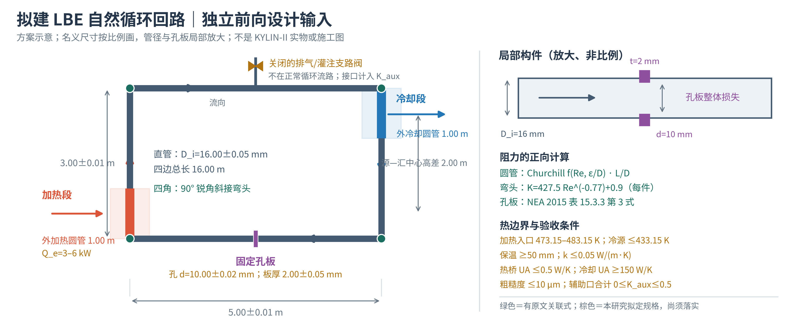

# 拟建 LBE 自然循环模型回路：各段怎么布置

这张图画的是 [11 月 8 日独立设计输入方案](lbe-forward-design-input-spec-20261108.md)，**不是 KYLIN-II 已建装置**。名义外廓按 5.00 m × 3.00 m 比例绘制；16 mm 管径和孔板孔径在右侧单独放大。正常循环按图中箭头：**右侧冷降段 → 下横段 → 左侧热升段 → 上横段 → 右侧冷降段**。

| 顺着流向 | 名义设计 | 主要作用与计算口径 |
|---|---|---|
| ① 右侧冷降段 | 高 3.00 m，顶部 1.00 m 外冷却圆管；内径全程 16 mm | 冷却侧带走循环热量，控制左下加热段入口为 473.15–483.15 K；冷却器能力、油温和 `UA` 是**拟定验收条件** |
| ② 下横段 | 长 5.00 m，中心装 10 mm 孔径、2 mm 厚固定孔板；至两端弯头各 2.50 m | 孔板按 NEA 2015 表 15.3.3 第 3 式正向算整体局阻；不以目标阻力反解孔径，也不再叠加单独突缩/突扩 |
| ③ 左侧热升段 | 高 3.00 m，底部 1.00 m 外加热圆管；内径全程 16 mm | 给定电输入 3–6 kW；沿程热损与物性变化一并进入能量和浮升方程；**模型侧不用环隙** |
| ④ 上横段 | 长 5.00 m，中部设正常运行时关闭的排气/灌注支路阀 | 主流路无内联阀；支路口、接口和错边的附加损失列入 `K_aux`，不把关闭阀本体当作主流路阻力 |
| ⑤ 四角与直管壁 | 四个 90° 锐角斜接弯头；总直管长 16.00 m，内径 16.00 mm | 弯头按 Al‑Tameemi–Ricco 指定几何的 `K(Re)` 式；圆管沿程按 Churchill 式。弯头实验用水/空气，迁移到 LBE 仍是**模型条件** |

红色和蓝色各代表一个 **1 m 长的加热/冷却段**；中心分别位于离底部 0.5 m 和 2.5 m，故中心高差名义 2.00 m。实际浮升压头按整圈 `ρ[T(s)]` 积分，**不强制用固定 2 m 高度替代温度场**。其余管段按保温与热桥规格计算散热。

图中**绿色**表示能定位到原文表/式的构件关系，**棕色**表示本研究提出的尺寸、公差或采购/运行规格。方案已把拟建模型的输入写成可审查对象；`K_aux≤0.5`、粗糙度上限、保温/热桥性能、冷却器 `UA` 尚需图纸和供货条件落实。它目前是**方案级条件物理域**，尚非已建台架的认证参数域，也未给整回路失真上界。

下载：[PNG 预览](lbe-loop-design-schematic-20261109.png) · [SVG 矢量图](lbe-loop-design-schematic-20261109.svg) · [PDF 矢量图](lbe-loop-design-schematic-20261109.pdf) · [生成脚本](lbe-loop-design-schematic-20261109.py)。
