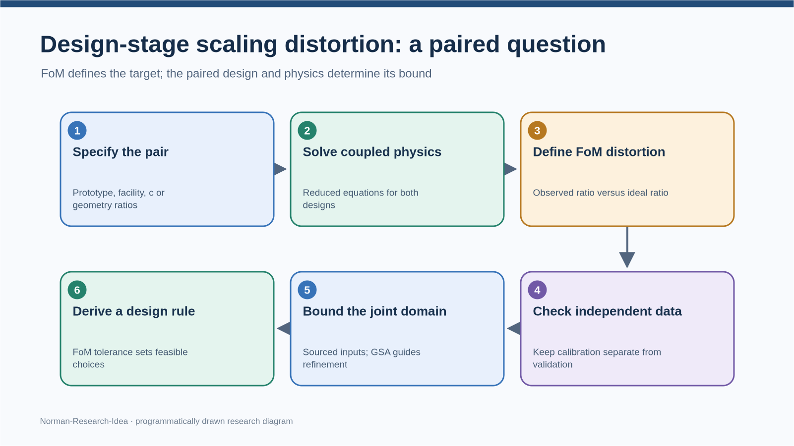

# 缩放比、FoM 与设计阶段先验失真：方法定位及成对脚本复核

**2026-11-01，聚焦复核与研究推进。** 使用 `norman-paper-reading` 对 Carnevali 等（2025）原文的相关段落及赵鹏程等（2020）表 1、3、5 再核对；使用 `norman-research-idea` 对上传的“成对案例失真恒等式与认证上界”HTML、Python、日志及 CSV 作反例审查和研究路线设计。上传 Python 在隔离目录复跑成功，日志除末尾换行外相同。附带[独立复算脚本](paired-scaling-logic-audit-20261101.py)与[结果 CSV](paired-scaling-logic-audit-20261101.csv)。**这不是论文投稿稿，也没有制作 PPT。**

## 先回答你的困惑

**我们的目标可以摆脱某一条缩比准则的“满足就相似”推断，但不能摆脱成对设计与参照比例。** 一个 FoM（例如流量）告诉我们关心什么；原型、候选台架、工况对应关系和“理想应该是多少”告诉我们何为缩比失真。若只有一台装置、没有原型或独立目标，可以研究它的流量上界或安全裕量，却不能把该值称为“原型—台架比例失真”。

`c=1/2` 不必作为唯一标量写进每个公式：若已给出所有两侧几何及工况，直接用这些**比值向量**也可以。但在设计阶段，`c` 或等价的几何/功率映射必须指定，才能算理想比值、实际雷诺数和可行设计集合。它不只是“决定地板”；**不存在普适的、仅由 c 决定的正失真下限**。上传材料自己在同一 `c=1/2` 下给出不同情景，说明失真还取决于同时保持了哪些条件；其所谓 `c=1/8` 的 10%“地板”来自“雷诺数效应未被抵消”的特定情景，不能推出任何准则下都做不到 3%。

一个清楚的数学问题是：给原型参数 `p_P`、台架设计映射 `p_M=T(c,z,p_P)`、两侧共享/独立的不确定量 `θ`，由同一组守恒方程得到 `y_P(θ)` 和 `y_M(c,z,θ)`。若文献准则给 FoM 的理想**原型/台架**比 `s_y(c,z)>0`，定义

`D_y(c,z,θ) = [y_P(θ)/y_M(c,z,θ)] / s_y(c,z) − 1`。

这里的 `s_y` 是**比较基准或设计目标**，并不假设该准则真的被台架满足。例如赵文取 `c=1/2` 时，表 1 给流量目标比 `s_m=2^(5/2)`、温升目标比 `s_ΔT=1`；研究问题恰是实际两侧结果离这些目标多远。

设计阶段要回答的是给定来源约束的 `Θ(c,z)` 后，`sup_{θ∈Θ(c,z)} |D_y(c,z,θ)|`；若还要选择台架尺寸，则求 `min_{c,z∈可行设计} sup_θ |D_y|`。**FoM 定义目标，缩比映射定义比较，模型给因变量，参数域才使“最大”有意义。** GSA 需要声明输入分布，它可排序、发现交互并指导分盒；普通 Sobol/HSIC 的排序本身不构成最坏上界。Sobol 的 `S1` 与 `ST` 分别看主效应与包含交互的总效应，没有“`ST` 饱和就必须改用 `S1`”的通用规则。摄动可给局部导数和候选极值位置，大扰动下仍需非线性方程及全域证明。

图由 `norman-research-idea` 本地 `render` **程序绘制**，是本文方法顺序，不是 Carnevali 原图。[可编辑 SVG](paired-scaling-method-map-20261101.svg)。

## Carnevali 原文究竟说了什么

| 原文位置 | 核对到的意思 | 可引用的界限 |
|---|---|---|
| PDF 第 2 页，引言第一条 bullet | 既有的某些失真可接受性判据 “remain rather subjective”；阈值未依失真对 FoM/PoI 的影响建立，举例为无量纲数比的 factor 2 | 可以写“FoM 影响与可接受性之间的定量关联仍需改进”；**不能**写“作者证明设计前失真分析为空白” |
| PDF 第 4 页，§3 开头 open issue (ii) | “how to quantify the impact and define the acceptability of a distortion for a specific reactor thermal–hydraulic transient” | 问题是特定瞬态中**量化影响及定义可接受性**，并非宣称所有先验方法不存在 |
| PDF 第 9–10 页，图 9 附近与结论 | 作者讨论缩比分析与 GSA 的互补，并把逐项修改输入的 hybrid calculations 作为揭示失真对 FoM 影响及改进判据的一条路径；第 10 页说明相关工作仍在进行 | 可以将“设计阶段、无实验结果、用可复算简化方程给条件界”作为**我们的待验证切入点**；不能从这一篇推断全球尚无不依赖系统程序的方法 |

因此较稳妥的论文措辞是：**Carnevali 等指出，既有某些无量纲失真阈值没有直接反映其对 FoM 的影响，并把特定瞬态中的影响量化和可接受性定义列为待解决问题。本文拟考察在明确的自然循环成对设计及输入有效域下，是否能以简化守恒方程给出设计阶段的 FoM 比例偏差界。** “尚未见到同类先验界”只能在补做最近文献检索并逐篇核读后作为限定性检索结论，不能归于 Carnevali 原话。

## 上传新模型：哪些能保留，哪些要纠正

### E1：真实的两个 FoM 点值不能改写

赵文表 5 是两侧 **FLUENT CFD**，并非台架实测。统一采用 `P/M` 比值和表 1 理想比，得到流量 `D_m=+2.876835%`、堆芯温升 `D_ΔT=−4.901244%`、堆芯压降 `D_Δp=+2.500297%`。每个值都只是该 FoM 的点值比较。上传脚本对这三项的算术复算正确。

代数上 `E=(1+D_m)(1+D_ΔT)=0.97834591`，但**不能**由此把 `D_ΔT` 改称 `1/(1+D_m)−1=−2.796388%`。后一个值额外施加 `E=1`，是“若热学比例完全保持”的**反事实温升**。原表的 `−4.901244%` 仍是观察到的温升比例偏差；两者之差可分解为热输入、比热、流量与温度口径的耦合项，不能简单宣布“全部不是物理失真”。

如果用赵文表 4 的 `c_p(T)`、表 5 所印进出口温度建单流道焓代理，原型约 **10.19998 MW**、台架约 **1.84211 MW**，各自相对表 3 设计功率 10/1.77 MW 有不同差额。二者之比是另一个诊断，**不是把两个单侧差额消成一个误差**；还需核原文热源控制体、旁流与出口平均方式。准确的能量恒等式要包含两侧区间平均比热 `c̄p`，且原型表 5 的 `130.0 K` 与所印 `663.16−533.15=130.01 K` 存在打印取整差。独立脚本逐项核对了这些因子。

### E2：`K_R` 目前是由 CFD 反演出的等效量，立方根还少条件

上传脚本把表 3 的外形 `1/0.5 m` 当圆管**净流面积**，并由表 5 的流量、温升反解等效损失 `K_P=133.81`、`K_M=148.86`、`K_M/K_P=1.11248`。但赵文第 5 页明确说明堆芯流道用等效面积和**多孔介质阻力**处理；表 3 的外形直径不提供逐段净流面积或水力直径。故这些 `K` 是在**额外几何假设**下定义的事后系数，代回原定义当然相等，不能据此称已独立辨识实际阻力。

在上传的集总动量式、两侧理想面积/高度比确实成立、同一密度斜率的条件下，严格的成对式是

`(1+D_m)^2 = (ρ_P/ρ_M) · (1+D_ΔT) · (K_M/K_P)`。

再令 `E=(1+D_m)(1+D_ΔT)`，才有

`(1+D_m)^3 = (ρ_P/ρ_M) · (K_M/K_P) · E`。

该案例的 `E≈0.978346`、`ρ_P/ρ_M≈1.000386`、`K_M/K_P≈1.112482`，合起来等于 `(1+D_m)^3≈1.088812`。若直接删去 `E` 与密度因子，上传的 `D_m=K_R^(1/3)−1` 会给 **+3.617%**，并非表 5 的 **+2.877%**。因此“一个 K_R 足以解释三个 FoM”只在另外证明热学比例、物性和几何条件保持时成立；从同一 CFD 点反演 `K_R` 再回代是**一致性校验**，不是设计前预测。

### E3：摩擦解释与上界的来源有数据回流

`K_R=1+w(f_R−1)+(1−w)δ` 可作**声明假设的损失分解**，不是赵文表 5 的恒等式。上传代码的 `Re_R≈0.3461` 使用了**表 5 已知的两侧 CFD 流量**，并把表 3 外形直径当流道直径，黏度还与赵文表 4 的版本不同。用这个 `Re_R` 固定 `f_R=Re_R^(−n)` 再做 `n,w,δ` 的盒，性质是**事后解释**。设计前 `Re_M` 依赖未知的 `ṁ_M`、真实流道 `D_h` 与温度，必须与动量和能量方程一起求或包络。

`δ=0, n=0.25` 时反解 `w≈0.370`，只证明**存在一种参数组合能贴合所反演的 K**，不证明“100% 由雷诺数效应解释”。即使接受这条代数式，一个 `K_R` 对应许多 `(w,δ,n)`；例如固定 `n=.25` 时 `δ=0` 给 `w≈0.370`，`δ=+0.05` 给正确的 `w≈0.246`。上传脚本 `w_from_n()` 把分母写成 `f_R−1+δ`，正确解应为 `(K_R−1−δ)/(f_R−1−δ)`；它输出的 **0.177** 不能代回原式。

`[n=.18~.30,w=.20~.60,δ=−.05~+.05]` 且 **冻结上述事后 `Re_R`** 时，`K_R` 对三个量确实单调：`∂K/∂n=−w f_R ln Re_R>0`、`∂K/∂w=f_R−1−δ>0`、`∂K/∂δ=1−w>0`，所以代数替代模型的八角点给精确范围 `K_R≈[1.00209,1.24488]`。但盒宽并非实测或制造公差，`Re_R` 也不是设计输入；再用**不满足案例热学关系的立方根式**转成 `[+0.07%,+7.58%]`，不能称为赵文台架“先验认证最大失真”。随机内点不越界也不增加证明力。

### E4：反解判据和跨案例表不能直接用于设计结论

上传的 `|D_m|≤3% ⇔ w≤0.305` 只在 `n=.25,δ=0,Re_R=.3461` **且立方根式其余前提成立**的单侧正偏差情景有效。如果仍用同一冻结 `Re_R` 替代模型，却要求对所声明的 `n∈[.18,.30], δ∈[−.05,.05]` 都守住 3%，门槛会变成约 **`w≤0.132`**；上传盒本身设 `w≥0.20`，已无法保证 3%。这同样只是替代模型的代数演示。其 `10%` 行 `w_limit>1` 的正确读法是：在 `n=.25,δ=0,w∈[0,1]` 下 **10% 目标自动满足**，而非“10% 设计不出来”。

“堆芯压降反解出负的 `w_c`”仅说明**额外假设**（同一个圆管面积、相同阻力分解、`δ=0`）无法同时解释该压降。赵文表 5 给的是堆芯单段压降，原文 CFD 又有等效面积/多孔介质；它不能证明该列与流量/温升“不同源”。跨案例 CSV 把 KYLIN 的台架/预期偏差取倒数改成原型/台架口径，还把 Cheng 的“约 20%”直接定为 **+20.000%** 并算 `K=(1.2)^3`。后者缺原文工况与正负号，属于**由假定百分比生成的标号**，不能当独立验证。

## 这轮可以怎样回应导师

| 批注或问题 | 可站住的回答 | 交付标准 |
|---|---|
| “大扰动怎么克服线性约束？” | 扰动导数用于局部导航，非线性简化方程给两个设计的 FoM，区间、解析单调或分支定界对**有来源的联合参数域**求界 | 给求根域、可行点、外界、间隙、无根记录；说明物性和关联式有效域 |
| “因变量不依赖数值程序怎么求？” | 可不依赖 CFD/系统程序，先从守恒式消元成少量隐式方程，再用一维求根或解析界；这仍含数值运算 | 明示方程和闭合、校准参数、留出的独立检验点；报告模型误差 |
| “为什么要 1/2，单纯 FoM 行不行？” | `1/2` 是一种候选设计选择；用全几何比向量也可以。FoM 单独无法给失真数值，需两侧设计和理想比 | 分开给固定 `c` 的最坏界与 `c` 可优化时的设计可行域 |
| “Carnevali 的空白是什么？” | 他明说的是特定瞬态失真对 FoM 的影响与可接受性如何量化；我们的**拟议切入点**是设计阶段的简化模型条件上界 | 补核最接近的方法文献，再谈“是否首次”；不能把推断写成 Carnevali 原话 |

测量不确定度是另一本账。若 `R_y=y_P/y_M`，相对标准不确定度的一阶 GUM 式含 `u_r(y_P)^2+u_r(y_M)^2−2 cov(y_P,y_M)/(y_Py_M)`；温升 `T_out−T_in` 还需两只热电偶误差与相关性。**GUM 标准不确定度不能直接加到最坏情况区间上**；若要保守外界，需给仪表准确度界、校准相关性和使用条件。当前没有这些资料，可以先写传播公式或做明确标注的情景曲线，不能算出受实测约束的“总不确定度带”。

## 下一步研究规划

| 优先 | 当前可执行动作 | 完成判据／转向条件 |
|---|---|---|
| **A1 固定成对问题** | 以赵文表 3/5 为回顾性核查点，选 `ṁ` 与堆芯 `ΔT` 两个 FoM，各自保留观察值；逐项标记表 3 设计、表 5 CFD、额外净面积假设和热功率口径。对设计阶段，另明示候选 `c` 或几何比向量与理想 `s_y` | 若无法给净流通面积、有效驱动高度和热源控制体，不能以赵文点反推出物理 `K` 再作先验预测 |
| **A2 建立前向成对方程** | 两侧共享物性，分别有几何/热损/阻力参数；`Re_M` 由未知台架流量联立求出，不再取 CFD 输出。先用独立量校准，保留一侧或另一工况作检验 | 若模型无法包含留出 CFD/实验点，先解释模型失配；不靠扩大无来源盒盖过去 |
| **A3 证明条件界** | 从公差、物性适用域、关联式验证范围和功率/冷源控制范围建立联合盒；求 `D_m,D_ΔT` 的有符号范围和绝对最坏值。GSA 排序与区间收敛分账 | 若只有任意 `[w,δ]`，只称“情景界”；若要说认证，计算舍入及根唯一性也需核查 |
| **A4 反解设计判据** | 用已验证的 `D_y(c,z,θ)` 界和有工程依据的 FoM 容限，求可行的 `c,z` 集合；单独给测量不确定度预算 | 若容限仅任取 3%/5%，称研究目标，不称安全验收阈值 |

创新性现在只能表述为**待检验的研究假设**：“能否在明确的自然循环成对设计和参数有效域内，利用不依赖系统程序的守恒模型，给出 FoM 比例偏差的可复算先验条件界，并反解设计选择？”这句话比“完全绕开缩放”准确，也与 Carnevali 的 FoM 问题相接；是否已有相同方法，仍须对 Zuber/FSA、H2TS、Xu/KYLIN 和后续研究做原文与近期检索。现有云环境对学术站点返回代理 403，本轮没有完成跨库新文献检索，也没有把上传 HTML 的题录当原文。

## 来源与复现

- 直接原文：Carnevali 等（2025），*Nuclear Engineering and Design* 444:114409，仓库 `papers/carnevali-2025-nucengdes-114409.pdf`，PDF 第 2、4、9–10 页；赵鹏程等（2020），《核动力工程》41(6)，用户前轮上传 PDF 第 4–6 页的表 1、3、4、5。Carnevali 研究 PWR 事故瞬态，本案例为 LBE 稳态自然循环；结论不可数值平移。
- 直接代码：本轮上传 `paired_identity_bound.py`、日志、三份 CSV 和 HTML。上传脚本隔离复跑；其数学结论按各自前提重新分类。[独立复算脚本](paired-scaling-logic-audit-20261101.py)只用 Python 标准库，结果见[CSV](paired-scaling-logic-audit-20261101.csv)。
- 未完成：新题录的全文核对、实物净面积/逐段阻力、仪表精度、设计前联合盒及真正的物理最大失真认证。图为程序绘制，不是原文图。

分析采用 norman-paper-reading 技能｜作者：N同学｜小红书：N同学｜B站/抖音：耐心的N同学

Analysis performed using the norman-paper-reading skill | Author: N同学 | Xiaohongshu: N同学 | Bilibili/Douyin: 耐心的N同学
