# Carnevali 等（2025）：尺度分析与全局敏感性分析如何互补

**阅读模式：deep。** 原文：S. Carnevali, P. Gaillard, J. L. Vacher, T. Fercoq, D. Bestion, “Combining sensitivity analysis and scaling analysis for nuclear thermal-hydraulic studies,” Nuclear Engineering and Design 444 (2025), 114409, DOI: 10.1016/j.nucengdes.2025.114409。已阅读提供的 11 页出版 PDF（正文、图 1–9、表 1–2、结论与参考文献）；图像为该 PDF 直接渲染的原图，非重绘。文中没有给出公开的原始计算数据，数据可用性声明称数据保密（PDF 第 10 页）。

## 核心判断与阅读范围

这是一项**方法结合与案例说明**，不是新的通用失真容许度标准。作者把此前对 6% 冷段小破口失水事故（SB-LOCA）的尺度分析，与同一案例的新全局敏感性分析（GSA）并列：前者从守恒方程识别系统、部件尺度的主导过程及跨尺度差异；后者在预先选定的模型参数范围内，评估局部闭合模型对指定评价量的影响。两条路径对若干主导现象和可能失真给出相近结论，但并未在本文完成逐项失真校正、建立普适容许阈值或验证其他事故情景（第 3.3 节、第 10 页结论）。

## 全文研究脉络

1. **问题。** 缩比综合实验装置（IET）无法同时保持所有热工水力过程与原型堆相似。仅比较无量纲群的比例，难直接回答某一差异是否会显著改变峰值包壳温度（PCT）等安全评价量。第 2 页指出既有部分容许判据（如某些比值界限）较主观，且未直接与评价量效应挂钩。
2. **尺度分析。** 先规定评价量 FoM、关注量 PoI、事故阶段 PhW；由质量、能量与压力守恒方程分解过程贡献，构建现象识别与排序表 PIRT，再比较 BETHSY、LSTF 和参考压水堆。这里使用此前研究的尺度分析结果（第 3、5–7 页）。
3. **GSA。** 专家先指定待变动的物理模型及其验证范围；用 CATHARE 对三种尺度各运行 500 组计算，通过散点、平行坐标、HSIC、扰动律指数 PLI 和 p 值研究模型参数与 FoM 的关系。原文说明 Sobol 指数因计算代价未采用（第 4–5 页）。
4. **对照。** 第一阶段 FoM 取稳压器排空时间；回流冷凝阶段取一、二回路压力交叉时间。比较两方法对相关过程的排序及不同尺度的响应形状（图 2–8）。
5. **建议。** 图 9 把“尺度分析识别、分类失真”和“GSA 定位参数的敏感区间”放在同一工作流中，并提出将来通过逐一修正失真的混合计算，以 FoM 变化建立更有用的可接受性判据（第 9 页）。这在本文主要是路线图。

## 关键设计选择

### D01：同一事故的三种尺度

研究对象是无高压安全注入和辅助给水的 6% 冷段 SB-LOCA。BETHSY 为全高度、约 1/100 体积缩比，LSTF 为全高度、约 1/48 体积缩比；与 900 MWe 参考 PWR 对照。BETHSY 与 LSTF 的回路、功率及边界条件也有差异，故观测差异不能简单归因于单一几何比例（第 5 页）。

### D02：按阶段设定问题

事故被划为过冷泄放、自然循环、回流冷凝、高品质破口排放和再充水五阶段。本文展示的 GSA 对照重点是前面阶段、直到一二回路压力交叉；不能把阶段结果直接外推为整个事故过程或 PCT 的完成量化（第 5–9 页）。

### D03：专家预选 GSA 输入

GSA 不是对一切可能现象无遗漏的自动搜索。被分析的闭合模型和变动范围事先基于专家判断及 SET 数据选定；只有进入输入清单的机制才可被本次排序。三种尺度各 500 次计算的统计关联也依赖所设分布和边界（第 4–5 页）。

## 原图与原表逐项核对

### 图 1：GSA 可视化工具示例

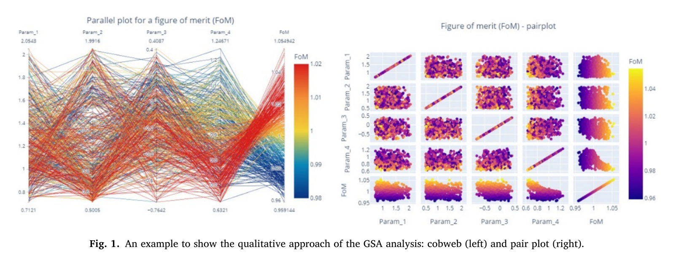

原文图 1，PDF 第 4 页。左为平行坐标，右为成对散点；颜色表示 FoM。此图是方法示意，不是本次 SB-LOCA 的定量结果。它说明参数“惩罚区间”与参数间相互关系如何被看见，不能把示例坐标数值当作事故结果。

### 图 2：稳压器排空时间的敏感性排序

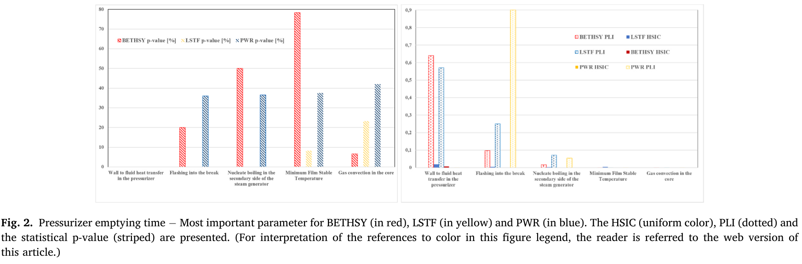

原文图 2，PDF 第 6 页；左图为 p 值，右图为 HSIC/PLI。图注与右图图例的颜色对应不完全一致，阅读时应按图例逐项核对。作者据较高 HSIC/PLI 和较低 p 值判断：稳压器壁面传热在 BETHSY、LSTF 重要，破口闪蒸与蒸汽发生器二次侧核态沸腾在不同尺度也有影响。图中的指数是模型参数对排空时间的敏感性，**不是尺度失真大小**。

### 表 1：过冷泄放阶段的过程贡献

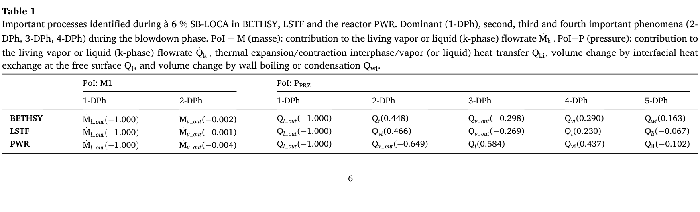

原文表 1，PDF 第 6 页。压力相关贡献中，参考 PWR 的稳压器蒸汽流出项约 −0.649，而缩比装置对应项在表中未列为相同主导项；作者认为这可能涉及 CATHARE 的两节点稳压器模型局限，不能仅凭该表判定真实反应堆物理的方向。液体破口流出项在三尺度均被规范为 −1.000，故这些相对贡献值也不是直接的绝对流量比较。

### 图 3：稳压器传热与排空时间

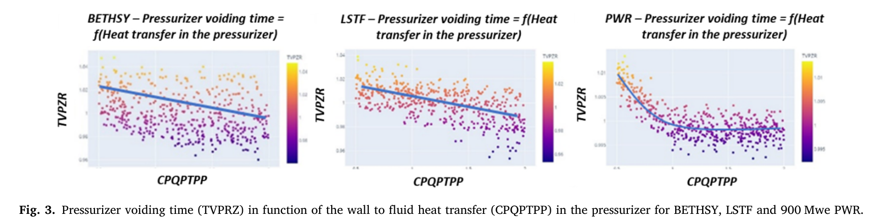

原文图 3，PDF 第 7 页，三幅散点分别为 BETHSY、LSTF、PWR。前两者的拟合线随传热参数增加而下降，PWR 下降后近似平缓；这提示模型作用区间存在尺度差别，但图本身没有验证变化原因。作者明确说未进一步研究 PWR 平缓区形成机制（第 6 页）。

### 图 4：破口附近闪蒸与排空时间

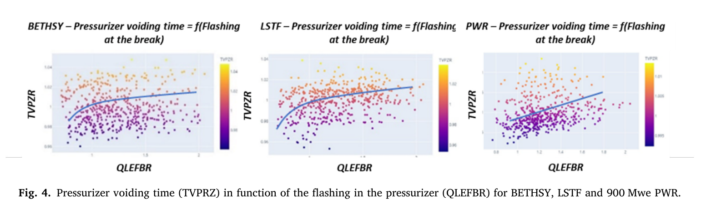

原文图 4，PDF 第 7 页。三尺度均可见排空时间随闪蒸参数增强而上升的拟合趋势；图中存在散点分散。作者给出的解释是更多蒸汽减小破口临界流，延长排空过程；这一解释来自模型计算，尚不等于独立实验验证的因果效应。

### 表 2：回流冷凝阶段的主导过程

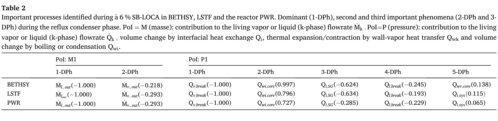

原文表 2，PDF 第 7 页。芯部壁面沸腾体积变化的相对贡献：BETHSY 0.997、LSTF 0.796、PWR 0.727；这给出跨尺度差异的候选过程。BETHSY 的芯部壁面对蒸汽传热贡献被列为 0.138，而其他两者未列为相同级别主导过程。数值是所选压力方程项在特定阶段的相对排序，不是直接的 PCT 偏差。

### 图 5：压力交叉时间的敏感性排序

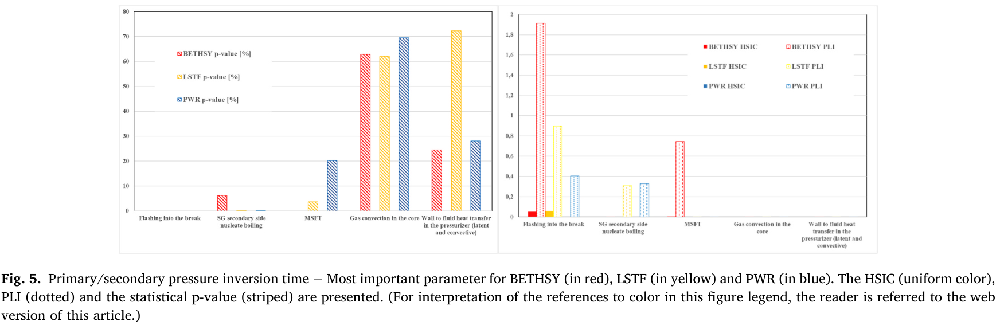

原文图 5，PDF 第 8 页。GSA 指向 BETHSY 的破口闪蒸与芯部最低稳定膜温 MSFT；LSTF/PWR 则突出破口闪蒸与蒸汽发生器二次侧核态沸腾。三尺度的主导闭合参数不完全相同，与表 2 所见 BETHSY 较强的芯部沸腾贡献相呼应。不过图中 BETHSY 的 MSFT p 值柱较高，不同指标并非完全一致；p 值、HSIC 和 PLI 应分别解读，不能把柱高混成一个统一“重要度”。

### 图 6：BETHSY 的压力交叉时间

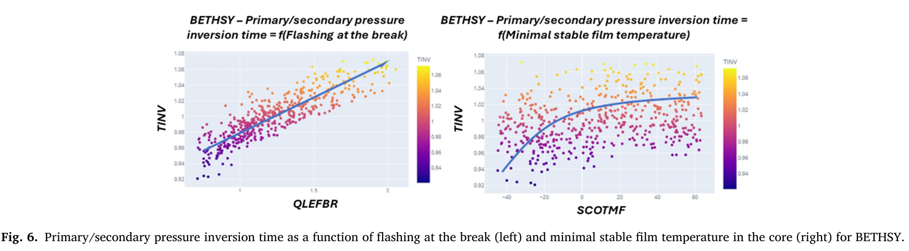

原文图 6，PDF 第 8 页。左侧破口闪蒸参数与压力交叉时间整体正相关，右侧 MSFT 的拟合趋势上升并趋于平缓。作者把 MSFT 效应与较长芯部干涸、再润湿及蒸汽产生联系起来；图是代码敏感性结果，尚需实验与模型有效性检查。

### 图 7：LSTF 的压力交叉时间

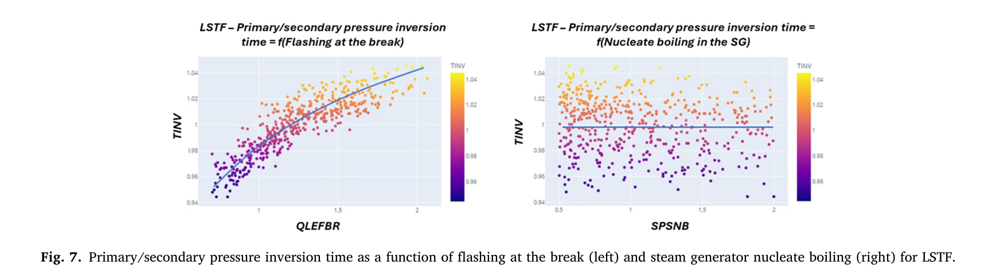

原文图 7，PDF 第 8 页。破口闪蒸增加对应较晚的压力交叉；二次侧核态沸腾增强的拟合线近似平缓或略提前，散点较分散。这里不应把“看起来平”解读为完全无效；作者仍把核态沸腾列为重要模型之一。

### 图 8：参考 PWR 的压力交叉时间

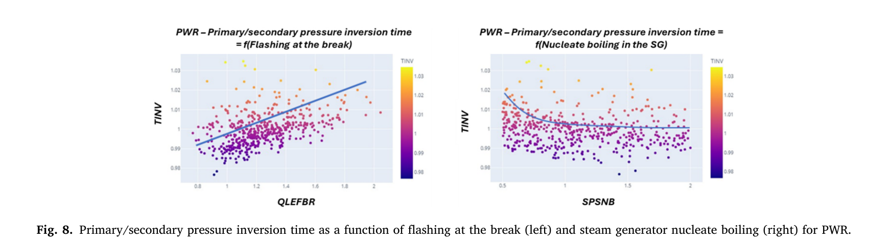

原文图 8，PDF 第 8 页。破口闪蒸趋势较 LSTF 更分散；二次侧核态沸腾增加对应交叉提前后趋稳。与图 6 对照，可见 BETHSY 的 MSFT 依赖不宜直接照搬到 PWR。

### 图 9：组合分析流程

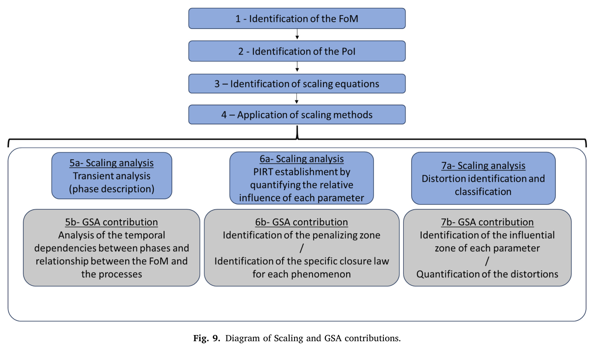

原文图 9，PDF 第 9 页。蓝色为尺度分析、灰色为 GSA 补充。流程从 FoM/PoI/尺度方程出发，经阶段分析与 PIRT，至失真识别（7a）和影响量化（7b）。图中 7b 是**方法框架中的目标**；不能仅因框图画出“量化”就声称本文已完成所有失真的 FoM 影响量化。

## 必要方程与物理含义

第 3 页式（1）为控制体的液、汽质量守恒：质量积累等于两相入口流量减出口流量。式（2）为能量守恒，并在所选事故中忽略泵的能量源。作者联立式（1）与（2）得到压力方程式（3），将压力变化与入口/出口流动、壁面及界面换热、沸腾/冷凝造成的体积变化率联系起来。

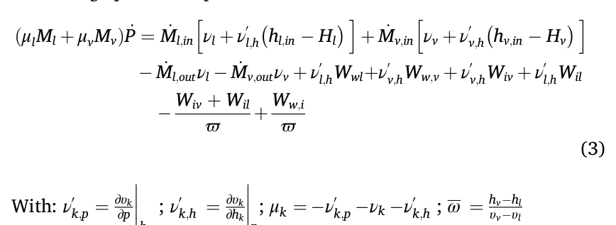

原文式（3），PDF 第 3 页。左端是压力改变造成的液汽体积变化率；右端是各种体积源、汇。比较三尺度的这些项，是识别具体失真的物理依据。式中体积控制体固定、出口焓取体积平均值等假设影响解释范围；不能仅用符号相似就认定两个尺度的瞬态响应相同。

## 证据卡

| ID | 主张 | 直接依据 | 支持程度与边界 |
|---|---|---|---|
| C01/E01 | 组合方法能在案例中找到相近的主导现象 | 图 2、5 与表 1、2，第 6–8 页 | 对这个 6% SB-LOCA 案例有支持；GSA 输入由专家预选，且尺度分析为既有工作 |
| C02/E02 | BETHSY 的芯部效应与其他尺度不同 | 表 2 的 0.997/0.796/0.727，图 5–8 | 指向潜在尺度效应；不能把相对方程项直接当 PCT 偏差 |
| C03/E03 | 稳压器传热的 FoM 关系在尺度间不同 | 图 3 与第 6 页讨论 | 模型内响应形状不同；PWR 曲线平缓区原因尚未研究 |
| C04/E04 | 破口闪蒸影响关键时间量 | 图 4、6–8 | 模拟参数敏感性可见；缺独立的失真校正对照 |
| C05/E05 | FoM 导向的失真可接受性判据仍待完善 | 第 2 页局限、第 9 页混合计算建议、第 10 页结论 | 作者明确作为未来工作；不是断言该领域完全无人研究 |

## 开放问题与未核实材料

- **量化边界。** 本文展示模型参数敏感性、相对过程贡献和潜在失真，却没有给出跨事故通用的“失真度 → FoM 偏差 → 可接受阈值”函数，也没有展示逐项校正后对照的完整结果。
- **先验与事后。** 原文明确讨论已有实验结果后的 a-posteriori 尺度分析；GSA 输入清单则是分析前由专家预设。作者没有把“先验失真度分析”定义成一个独立、完成验证的方法。不能将这两种“先”混同。
- **外推。** 仅一个事故类型与三种尺度；作者要求增加事故情景并同步开展两种分析。数据声明为保密；未得到输入卡、500 次样本和原始实验数据，因此未复现图表。
- **文献。** 已核查论文末尾参考文献的题录，但当前环境未取得各被引文献全文；对它们具体结论的说明限于本论文中的引用和题名。详细线索见 paper-literature-20261022.md。

## 未来研究启示

1. **评价量驱动的失真判据（作者路线，需验证）。** 先用尺度方程定位偏离的过程，再在模型有效的参数区间里逐项修改输入，观察压力交叉时间、PCT 等 FoM 的变化；这比只看某个无量纲群是否超阈值更接近安全问题。条件是系统代码已通过相关实验验证，且可单独控制待校正过程。
2. **区分装置差异与模型差异（分析建议）。** 图 3 的 PWR 曲线形状和稳压器模型局限说明，参数响应差别未必都来自几何缩比。应把几何、边界条件、离散化和闭合律分别设为对照；否则“尺度失真”可能混入模型误差。
3. **按阶段建模（作者路线）。** 本文只覆盖到压力交叉的重点阶段。若目标是 PCT，可把回路水封清除、芯部干涸和再润湿时刻连到同一时序图，追踪前一阶段误差如何影响后一阶段，尤其关注 BETHSY 的 MSFT 依赖。

## 下一步研究规划

**通用研究计划；未假设你的项目已有 CATHARE 许可或实验数据。**

| 优先级 | 可检验问题与方法 | 对照、判断与交付 |
|---|---|---|
| A01 首先 | 取得三尺度相同工况的输入卡、实验曲线与 FoM 定义；核对破口尺寸、功率、稳压器初始状态、闭合律区间，重建图 3/5 的排序 | 交付一份可追溯的工况与参数矩阵。若输入或实验不可得，先停在文献与方法层面，不声称复现 |
| A02 随后 | 对表 2 的芯部沸腾项和图 5 的 MSFT/闪蒸参数做逐项扰动与组合扰动，比较压力交叉时间和 PCT | 保留未修改计算及实验曲线为基线；报告方向、幅度和不确定性。若单项影响不稳定，转向参数交互和模型校准 |
| A03 扩展 | 换一类 LOCA 工况或另一个缩比装置，按相同流程复测所得失真判据 | 交付跨工况误差与适用范围；若 FoM 效应方向改变，判据应限定工况，而非宣称通用 |

## 来源与阅读记录

- 直接阅读：仓库提供的出版 PDF，11 页，DOI 10.1016/j.nucengdes.2025.114409；原文可在仓库 papers/carnevali-2025-nucengdes-114409.pdf 核对，报告所引原图见 paper-reading-20261022-assets/figures/。
- 图 1–9、表 1–2 的原图来自该 PDF；第三方文献全文未在本次阅读中验证。
- 公式（3）以原文裁图保留，未从多栏 PDF 抽取结果猜测符号。

分析采用 norman-paper-reading 技能｜作者：N同学｜小红书：N同学｜B站/抖音：耐心的N同学  
Analysis performed using the norman-paper-reading skill | Author: N同学 | Xiaohongshu: N同学 | Bilibili/Douyin: 耐心的N同学
