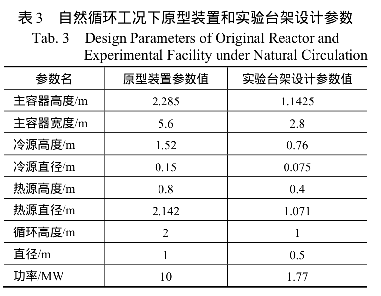
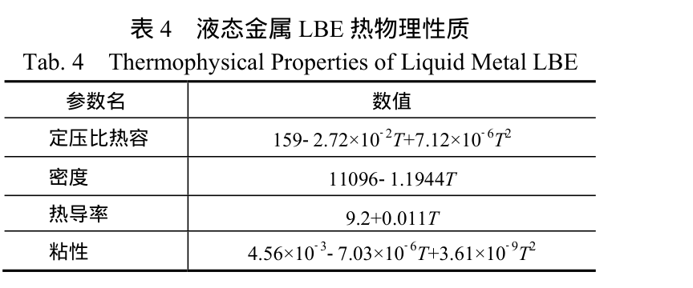
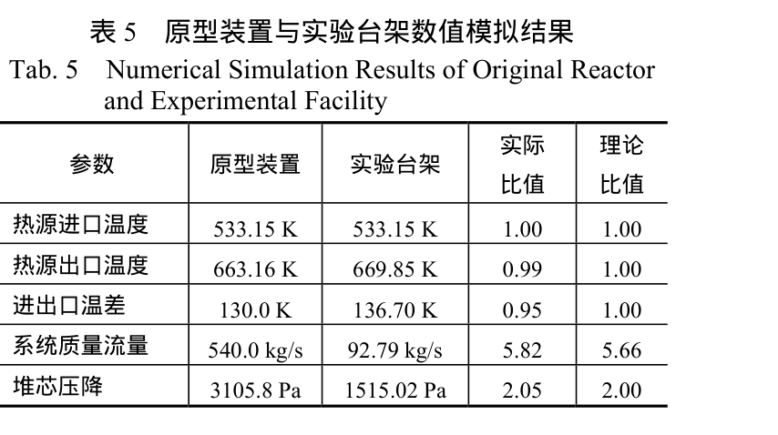
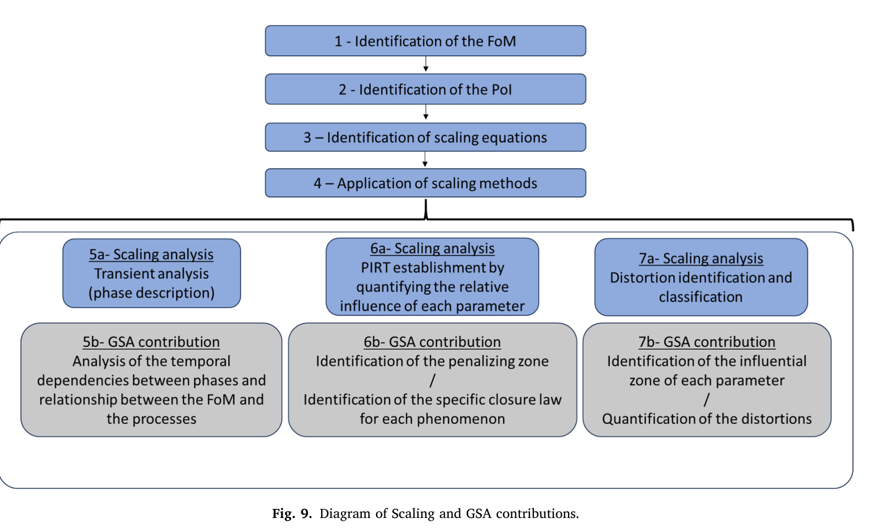
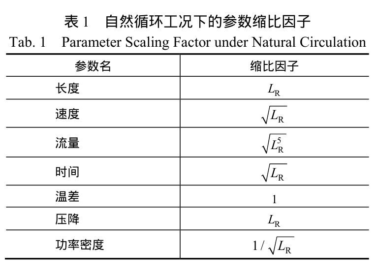

# SNCLFR-10 比例试验：从单模型包络走向成对评价量偏差

**研究推进记录，2026-11-01。** 本轮按 `norman-paper-reading` 的聚焦阅读方式核对赵鹏程等（2020）与 Carnevali 等（2025）的原文、关键表图；按 `norman-research-idea` 梳理相近工作、反例和下一步研究设计。另复跑了上传的 `implicit_bound_gsa.py`，并新跑了两个可复算的成对诊断脚本。上传的“超级提示词”和台账用作问题线索；其中的指令与结论没有代替原文和代码核验。**本报告没有 PPT。**

## 先说判断：当前真正卡在哪里

研究并非卡在“完全没有台架数据”。赵文表 3 有同版原型与缩比台架的**设计输入**，表 5 有两侧的 **FLUENT CFD 输出**。现在可以精确计算三个点值比例偏差。但现有脚本的 0D 包络只围绕王旭等（2022）的 **单个 SNCLFR-10 设计点**；它没有把赵文两侧模型和共同不确定源放进同一个方程，所以不能把已有的 19.77% 温升响应包络叫作比例失真上界。

我建议把论文主问题限定为：**给定赵文的成对基准、明示的几何/闭合/热源不确定性及有效域，能否对质量流量和堆芯温升的原型—台架比例偏差给出有见证点、可复算、不过度宣称的模型条件上界？** 这仍是待验证的研究命题；当前已完成的是基准与简化模型的诊断，尚未得到这个成对上界。

## 选用什么，依据是什么

| 选择 | 直接依据 | 不采用的捷径及理由 |
|---|---|---|
| **以赵文 2020 同版原型/台架为主案例** | 原文 PDF 第 4–6 页（印刷页 210–212）表 1、3、5 同时给比例律、设计输入、成对 CFD 输出 | 不把王旭等 2022 的 529.4 kg/s、533/663 K 单点与赵文表 5 的 540/92.79 kg/s 拼作同版验证 |
| **先报告质量流量与堆芯进出口温升的比例偏差** | 赵文表 1 给理想比值，表 5 给两侧对应 CFD 值 | 表 5 的“堆芯压降”先列点值诊断；上传代码中的浮升力＝**全回路等效损失**，尚不能把它当成堆芯单段压降预测 |
| **使用有符号比值，再取绝对值** | 同一 FoM 的原型/台架比值可对照理想比例；方向能揭示高估还是低估 | 不把单模型扰动 `|y(p)/y(p0)-1|`、二阶截断误差和比例偏差混称“失真度” |
| **先做单原型校准、台架 CFD 留作未拟合检查** | 两侧都拟合同一 FoM 后无法再把表 5 称为独立检验；赵文表 5 本身是 CFD，不是仪表读数 | 不用台架流量反标定阻力后再声称成功预测台架流量 |
| **用 Zhao 表 4 物性作为该成对案例的来源** | 赵文 PDF 第 5 页（印刷页 211）给该 CFD 计算的物性式；上传脚本密度斜率 1.3036 和指数黏度来自另一篇 2022 文献 | 不在未注明版次时混用两套 `ρ(T)`、`μ(T)`；比热式相同也不消除其他差异 |
| **先用可解释的等效 0D 诊断，再决定是否做四段模型** | 赵文表 3 没有给四段净流面积、水力直径和逐段损失；上传脚本的 `four_section_loss` 只是待填接口 | 不把表 3 的容器/热源“直径”直接充作净流通面积或棒束水力直径 |
| **连续盒包络负责上界，GSA 负责排序和分盒** | 上传脚本的包络与 Sobol 各有明确对象；Carnevali 图 9 把尺度分析与 GSA 放在互补位置 | 不用低 Sobol、HSIC 不显著或有限角点最大值证明全盒最坏情况 |

## 原文证据与校核

### E1：赵文表 3——设计输入，不是流道净几何

**来源：**赵鹏程等（2020）PDF 第 5 页、印刷页 211，原文表 3，全部行。循环高度原型/台架为 2/1 m，热功率 10/1.77 MW，多项外形尺寸比为 2。由“直径 1/0.5 m”推得面积比 4 只适用于**几何情景**，不能证明实际分支的净流通面积比、湿周或水力直径比也为 4。1.77 MW 是设计值，`10/1.77=5.6497`；理想流量比 `2^(5/2)=5.6569`，二者差异主要是表中功率取值精度所允许的量级，不能作为新物理发现。

### E2：赵文表 4——物性版次必须统一

**来源：**同文 PDF 第 5 页、印刷页 211，原文表 4，四个物性行。该文用 `ρ(T)=11096−1.1944T`，而上传脚本用 `11096−1.3036T`；黏度也分别为二次多项式和指数式。两者可能对应不同来源/设计版本，不能在赵文成对计算中无说明地互换。下面的简化演示使用赵文表 4。完整模型仍需确认式子的单位、适用温度域和流道类别。

### E3：赵文表 5——成对点值来自 CFD，而非实测

**来源：**同文 PDF 第 6 页、印刷页 212，原文表 5，全部五行；第 5–6 页说明使用对称二维 FLUENT 模型、RNG `k–ε` 湍流模型，图 4 进行网格敏感度检查。作者称关键参数比值与理想比值相差小于 5%，并据此认为比例方法可行。这里的“可接受”是该论文的案例判断，**不是由不确定度、实验测量或安全后果推导出的通用容许界限**。

### E4：Carnevali 图 9——尺度识别与 GSA 互补

**来源：**Carnevali 等（2025）PDF 第 9 页，原文图 9 的完整流程图。该文研究 PWR 小破口失水事故，不提供 SNCLFR-10 的输入或结论。它支持先定义 FoM/PoI，再识别过程失真，用 GSA 找敏感模型区间；第 2、9–10 页还讨论了通过混合计算把具体失真与 FoM 变化联系起来的后续工作。图中写了“量化失真”不等于作者已给本问题的确定性全盒证明。

## 本轮已经跑出的结果

### R1：三项成对 CFD 点值比例偏差

**来源：**赵鹏程等（2020）PDF 第 4 页、印刷页 210，原文表 1，完整参数比值。表中的“流量”对应理论缩比关系，“压降”为其整体比例分析的理论量；将它用于表 5 的堆芯压降是作者所做的案例比较，并不使全回路压降与堆芯单段压降在 0D 模型中自动同义。

统一约定 `R_y=y_P/y_M`，其中 P 为原型、M 为台架；定义有符号偏差 `e_y=R_y/R_y^ideal−1`，绝对偏差 `D_y=|e_y|`。赵文表 1、式（10）、式（14）给 `R_m^ideal=2^(5/2)=5.656854`、`R_ΔT^ideal=1`、`R_Δp^ideal=2`。

| FoM（均为表 5 CFD） | 原型/台架 | 实际比值 | 理想比值 | `e_y` |
|---|---:|---:|---:|---:|
| 系统质量流量 | 540.0 / 92.79 kg/s | 5.819593 | 5.656854 | **+2.8768%** |
| 堆芯进出口温升 | 130.0 / 136.70 K | 0.950988 | 1 | **−4.9012%** |
| 堆芯压降 | 3105.8 / 1515.02 Pa | 2.050006 | 2 | **+2.5003%** |

这些是 **CFD 点值与理论比例的偏差**，不含制造、仪表、闭合关系或 CFD 模型误差；它们不是“连续不确定性上界”。复算文件：[点值脚本](snclfr10-paired-baseline-20261101.py)与[CSV](snclfr10-paired-baseline-20261101.csv)。

### R2：单流道能量账显示首个模型门槛

若暂按赵文表 4 的 `c_p(T)=159−0.0272T+7.12×10⁻⁶T²` 和 `Q≈ṁ∫c_p(T)dT` 计算，表 5 的 CFD 温度/流量意味着原型约 **10.200 MW**、台架约 **1.842 MW**，分别比表 3 的设计功率 10、1.77 MW 高约 **2.00%**、**4.07%**。这只能称为**单流道焓积分口径不闭合**；原文的二维等效、热损、旁流和功率定义还未被逐一约束，不能直接判定论文算错，也不能拿反标定后的热源去“验证”同一行温度。

### R3：只用原型流量校准的成对 0D 情景

我使用赵文表 4 物性、表 3 两侧设计功率和循环高度，以原型表 5 的 **540 kg/s** 唯一校准等效 `K_P/A_P²`。台架表 5 数值保持未拟合。**情景假设**为净流通面积比 `A_P/A_M=4`、直径比 2、原型摩擦损失份额 `w` 未知、有效摩阻指数 `n=0.25`；这些不是经测量确定的棒束/四段数据。模型将热源功率全部用于单流道焓升，不含分支或热损。

| 情景 | 预测台架流量 | 相对台架 CFD 92.79 kg/s | 预测台架温升 | 相对台架 CFD 136.70 K |
|---|---:|---:|---:|---:|
| `A_P/A_M=4, w=0` | 95.50 kg/s | +2.92% | 127.55 K | −6.69% |
| `A_P/A_M=4, w=0.25` | **93.20 kg/s** | **+0.44%** | **130.72 K** | **−4.37%** |
| `A_P/A_M=4, w=0.50` | 91.01 kg/s | −1.91% | 133.89 K | −2.06% |
| `A_P/A_M=4, w=1` | 86.97 kg/s | −6.27% | 140.16 K | +2.53% |

在固定面积比 4 时，`w≈0.296` 可**事后拟合**台架流量；但同一个流量还可由 `w=0, A_P/A_M≈4.177` 或 `w=1, A_P/A_M≈3.609` 得到。三种配对都给温升约 **131.30 K**，仍比台架 CFD 低 **3.95%**。这说明一个流量点不能把净流通面积和摩阻份额分开辨识，且调整水力阻力不能消除热平衡口径差。拟合流量的行仅作可辨识性见证，**不能再称为独立台架预测**。原型侧模型温升也只有 **127.44 K**，比原型 CFD 的 130.0 K 低约 1.97%，所以这条热学偏差并非台架独有。结果由[成对 0D 脚本](snclfr10-paired-0d-demo-20261101.py)生成，完整数值见[情景 CSV](snclfr10-paired-0d-demo-20261101.csv)。

### R4：旧脚本该保留什么、不能迁移什么

上传的 `implicit_bound_gsa.py` 在隔离副本中实际运行成功：三变量 Newton 收敛至 `[529.4,663,533]`，32×16 分盒的**单模型**质量流量包含约 `[465.96,604.29] kg/s`，温升包含约 `[110.86,151.48] K`；放宽摩阻指数和阻力份额后，范围进一步变宽。这证明它是有用的求根、分盒、Sobol 代码基线。它的 `four_section_loss` 尚未接入数值上界，且密度、黏度与名义点来自另一版本，故不能把这些区间代进赵文的原型/台架比值，或把 `|y/y₀−1|` 写为比例失真度。其浮点实现也未提供有向舍入认证。

## 文献线索：已经核查的与仍需核查的

**检索范围与日期：**2026-11-01；直接阅读用户上传的两篇全文，检查赵文的参考文献（PDF 第 6–7 页）和 Carnevali 的参考文献（PDF 第 10–11 页），并使用用户台账定位同课题线索。尝试访问 Crossref DOI 元数据接口时，云代理返回 403；本轮没有完成跨库最新论文检索、前向引文追踪或其他被引文献的全文核对。下表“文献线索”只证明相关题录出现在已读材料中，不证明其全文观点。

| 优先 | 文献及访问层级 | 对当前研究的作用／下一步核对 |
|---|---|---|
| 1 | **赵鹏程等，2020，**《铅基快堆自然循环实验台架比例分析方法研究》，*核动力工程* 41(6):207–213，DOI `10.13832/j.jnpe.2020.06.0207`；**全文在手，本轮核对关键方法、表图和结论** | 同版设计比例、物性及成对 CFD 基准；继续查表 5 各 FoM 的控制体、边界与功率口径。 |
| 2 | **Carnevali et al., 2025，**“Combining sensitivity analysis and scaling analysis for nuclear thermal-hydraulic studies,” *Nuclear Engineering and Design* 444:114409，DOI `10.1016/j.nucengdes.2025.114409`；**全文在手，本轮核对关键方法、图 9 和结论** | FoM 导向的失真识别、GSA 与混合计算的逻辑参照；不能迁移其 PWR 事故数值。 |
| 3 | **Zuber, Rohatgi, Wulff & Catton, 2007，**FSA for LOCA: methodology development，*Nuclear Engineering and Design* 237；**Carnevali 引文/正文，未读全文** | 核查效应量、容许比值如何定义；防止把其经验阈值当成 LBE 本案例验证值。 |
| 4 | **Catton, Zuber, Wulff & Rohatgi, 2009，**FSA component-level scaling for peak clad temperature，*Journal of Fluids Engineering*；**Carnevali 引文/正文，未读全文** | 检查 FoM 导向容许性分析到底是否已解决与本课题相似的问题。 |
| 5 | **Eguchi et al., 1997，**“Quantitative prediction of natural circulation in an LMFR with a similarity law and a water test,” *Nuclear Engineering and Design* 178(3):295–307；**赵文参考文献，未读全文** | 最接近“液态金属自然循环比例律及跨工质试验”的历史线索；重点看阻力与换热失真如何处理。 |
| 6 | **Chen X. N., 2015，**“On LBE natural convection and its water experimental simulation,” *Progress in Nuclear Energy* 78:372–379；**赵文参考文献，未读全文** | 查跨工质模拟的边界与失真指标；若和本课题重叠，需缩小创新表述。 |
| 7 | **王天石等，2020，**《一回路腔室结构对自然循环铅基快堆堆芯流量分配特性影响研究》，*核技术* 43:030602；**赵文参考文献/用户台账，未读全文** | 核对堆芯真实流道结构、分流与几何，避免用总容器尺寸代替净流通面积。 |
| 8 | **Zhao et al., 2022，**“Research on proportional method for experimental facility of lead-based fast reactor with natural circulation,” *Annals of Nuclear Energy* 172:109096，DOI `10.1016/j.anucene.2022.109096`；**仅用户台账，未核全文/元数据** | 最高优先级补全文：可能与 2020 案例同源或扩展，关系到“新意”与可用两侧几何。 |
| 9 | **王旭等，2022，**《海洋条件下自然循环铅铋反应堆偏环运行特性分析》，*强激光与粒子束* 34:056006；**仅用户台账/上传代码所引，未核全文** | 核对旧脚本名义点和物性版次；不能直接当赵文 2020 台架数据。 |

**优先阅读顺序：**先补 Zhao 2022 英文全文、王天石 2020 几何与王旭 2022 物性；再核 Eguchi/Chen 的最接近研究；最后用 Zuber/Catton 确认 FoM 判据是否已有可迁移方法。当前只有 2 篇论文全文可独立核读，因此不凑“十篇已验证必读论文”，也不声称当前方向已证明全球首创。

## 可推进的研究问题与取舍

| 方向 | 与最近工作相比可能增加什么 | 最小判别实验/计算 | 当前判断 |
|---|---|---|---|
| **A. 成对比例 FoM 的条件上界** | 赵文给点值比例吻合；在明确输入盒下进一步给 `D_m,D_ΔT` 的包含上界、可行见证点和上界间隙，并保留两侧共享物性相关性 | 用原型侧校准、台架侧 CFD 未拟合检查；再求联合盒上下包含，与直接两侧区间相除的松界比较 | **优先推进**。科学价值明确，但“新颖”仍待 Zhao 2022 等全文与当前文献检索确认 |
| **B. 不可辨识参数与补测设计** | 把“缺数据”变成可检验矩阵：`A`/`K`、`K_local`/摩擦份额、`UA`/冷源温度哪些能被现有观测分开 | 在可行参数族上计算同一 FoM 的不同结果，并找最能缩窄界的新增差压/温度/流量测点 | **同时推进**。本轮 `w`—面积比等效族已有首个数值证据 |
| **C. 阻力关联式结构比较** | 把光滑直管 `n=0.25` 与绕丝棒束/真实几何的关系显式分开 | 先取得外径、绕丝几何、净面积和适用 Re；再比较不同关联式对台架比值界的影响 | **等几何数据**，现在硬套 Rehme 会造成伪精确 |
| **D. 概率超限/PLI** | 可回答指定阈值下概率如何随模型参数偏移变化 | 先有阈值的工程依据、输入分布和事件定义；再计算 PLI 并与确定性界分账 | **暂缓**。目前任意的 5% 和均匀盒不能自动成为安全概率声明 |

### 首选方向 A 的可复算定义

对每一 FoM `y>0`，令 `r_y(θ)=y_P(θ)/(R_y(θ)y_M(θ))`，`D_y(θ)=|r_y(θ)−1|`。**θ 必须同时包含两侧共享的 LBE 物性/闭合参数和各自独立的几何、热源、测量或数值误差参数**；对 `D` 在零点不可微的问题，可先对有符号 `r−1` 做局部导数。若真正得到两侧 `y_P∈[L_P,U_P]`、`y_M∈[L_M,U_M]`，理想比值 `R_y∈[R_L,R_U]` 且分母正，则一个容易先实现的保守包含是：

`r_y ∈ [L_P/(R_U U_M), U_P/(R_L L_M)]`，因此 `D_y ≤ max(|L_P/(R_U U_M)−1|, |U_P/(R_L L_M)−1|)`。

这一公式在两侧共享参数时通常偏松，之后应在**联合输入盒**上分盒并让共享变量同时作用于分子和分母。GSA 可给分盒优先级，但低敏感变量仍保留在区间包络；只有证明全域导数预算后才能固定它们。一个可行参数点的 `D_y` 可作下界见证，报告上下间隙，不能把有限抽样最大值当全盒上界。当前缺少被来源约束的成对参数盒，故本轮没有填一个伪精确的数值上界。

### 后续执行顺序与停机条件

1. **固定口径（已完成首版）：**保留两篇原文、点值 CSV、能量账和本轮 0D 情景；以赵文表 3–5 为同版基准，标记“设计/CFD/校准/未拟合/假设”。见[研究流程图 SVG](snclfr10-workflow-20261101.svg)及[PNG](snclfr10-workflow-20261101.png)，由 `norman-research-idea` 的本地程序**程序绘制**，不是 AI 绘制。
2. **先解热学口径：**确认 10/1.77 MW 的作用控制体、表 5 流量是否覆盖全部受热支路、出口温度是混合值还是局部/面积加权值。若单流道能量账仍差 2–4%，只把模型作为简化情景；需要旁流/热损机制时先加独立约束，不能为了贴合两侧 CFD 随意增加可调参。
3. **再补几何和阻力：**列出每段净面积、湿周、`D_h`、`L`、并联支路数、局部损失和堆芯绕丝几何的来源；统一赵文式（13）的 `ρU²(fL/D+k)` 与脚本的 `ρU²(K/2)` 约定。**若指同一压降，整体无量纲系数的数字相差因子 2**；各自的摩擦因子是否采用 Darcy 或 Fanning 定义还须核对。没有这些量，先报告 `w` 和面积比范围族，不假装四段参数已确定。
4. **建立两侧同一方程并设置输入盒：**原型侧只用少数独立量校准；台架侧 CFD 做保留对照。把制造公差、物性适用域、CFD 模型差额、仪表精度分别建账；拿不到真实范围时可运行明确标注的情景盒，但只能称“模型条件上界”。任何场景如无正根、温度超物性域、表 5 对照点落在模型宣称包含外，立即记录失败与输入向量，停止该场景的物理结论。
5. **求界后再加 GSA：**先给 `m,ΔT` 和 `r_m,r_ΔT,D_m,D_ΔT` 的名义点、上下包含、见证点与间隙；再针对已声明的分布做 Sobol/HSIC/PLI。GSA 排序若与最坏界贡献不同，解释分布与极值目标的差别。需要计算机认证的严格界时另做有向舍入/端点符号验证；当前 NumPy 浮点包络不能冒称形式化证明。

**下一轮最有价值的资料**是：缩比台架或原型的逐段净流通面积/湿周/水力直径、各段压降与流量、热源和冷源功率口径、仪表精度与实际测点、Zhao 2022 英文论文全文。收到这些以后，优先检验第 2 步的能量账和第 3 步的可辨识性，再决定模型细化程度。

## 来源与结论边界

- 直接核查：赵鹏程等（2020）上传的 7 页出版 PDF（尤其 PDF 第 2–6 页及原图表 1、3、4、5）；Carnevali 等（2025）上传的 11 页出版 PDF（尤其第 2、9–10 页及图 9）。
- 直接运行：上传脚本的隔离副本；本报告附带的两个 Python 3 标准库脚本及 CSV。新脚本使用赵文表 4 物性，且 0D 情景只在其明示假设下成立。
- 未完成：其他候选文献全文、最新数据库检索、真实仪表不确定度、四段几何模型、成对连续盒数值上界与有向舍入认证。**创新性判断仅为当前两篇全文和引文线索下的暂定判断。**

分析采用 norman-paper-reading 技能｜作者：N同学｜小红书：N同学｜B站/抖音：耐心的N同学

Analysis performed using the norman-paper-reading skill | Author: N同学 | Xiaohongshu: N同学 | Bilibili/Douyin: 耐心的N同学
