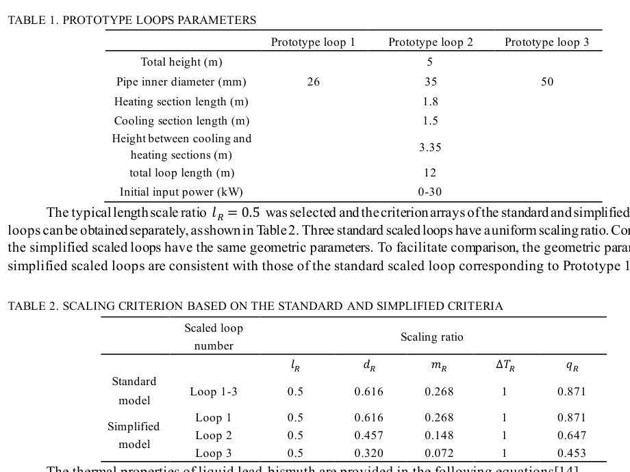
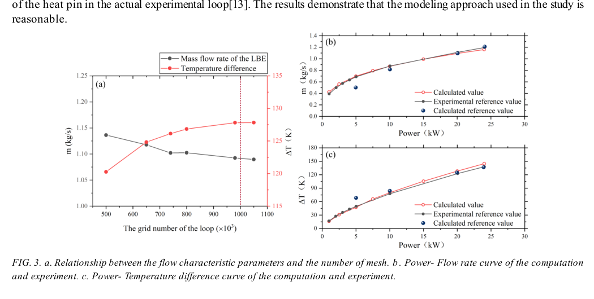

# 源无关界 v2 复核：Xu 原文、单参数证明与留出点口径

**2026-11-02。** 使用 `norman-paper-reading` 对本轮上传的 Xu FR26-170 原文做聚焦核读，使用 `norman-research-idea` 的证据与反例框架复跑 `source_free_bound_v2.py`。其同目录依赖 `loop_audit_repair.py` 未随本轮附件上传；以仓库已有的[修订等价脚本](loop-audit-repair-corrected-20261101.py)放入临时目录后，**242 条程序日志与上传日志按行一致**（以实际日志行数为准）。本报告区分“数值复现”“模型内证明”和“实验验证”。

## 选用了什么，依据是什么

| 选择 | 依据 | 判断用途 |
|---|---|---|
| 直接核读 Xu FR26-170 第 3–5 页 | 本轮拿到[原始 PDF](xu-fr26-170-original-20261102.pdf)，能核对表头、式(3)、式(10)–(18)和 Fig. 3 图例 | 决定 `3.35 m`、`q_R` 与原型/实验关系究竟有多硬 |
| 逐行检查 v2 的 `section_mono()` 与 `enclose()` | 论文拟称“认证包络”，其关键在**连续区间**导数界和有向舍入，而非末位数字能否重复 | 判断 `7.8×10^-14` 间隙能否作为已证明包含误差 |
| 保留 Zhao 的一维理想模型，另给保守解析界 | 该模型有条件结构价值；应尽量给出**真能说明为何有界**的结果 | 与 v2 的数值端点 `+9.7782%` 分开报告 |
| 只对 17.9 kW 点做控制体与物性审计 | 本轮未上传 Yue/Li 原文；v2 已将实测流量与温升称为同一个热平衡约束 | 防止把计算构造的加热段温升当独立验证 |

## Xu 原文：证实了什么，未解决什么

### 表 1 与表 2：3.35 m 和 `q_R` 有一手依据

**来源与覆盖：**Xu et al., IAEA FR26 paper 170，PDF 第 4 页，完整表 1/2 及标题。表 1 明列总高 `5 m`、内径 `26 mm`（原型回路 1）、加热/冷却段长 `1.8/1.5 m`、两段间高差 **`3.35 m`**、全回路长 `12 m`；§3.2 文字说明“Prototype loop 1”的几何参数与 KYLIN-II 一致。于是 `3.35 m` 不再只是我们的轴向集总温度积分的巧合，**它也是 Xu 所建原型的表列高差**。不过表 1 **没有给热段/冷段的水平长度分配**，此前把余下水平长度按 `3:4` 分到两侧仍是自由假设，不能删除。`3.35 m` 也不自动证明实物全回路任意温度分布的有效浮升积分恰好等于 `3.35·(T_h−T_c)`。

**表 2** 的标准方案 `l_R=.5,d_R=.616,m_R=.268,ΔT_R=1,q_R=.871` 已直接核对。Xu 第 2–3 页式(3)和符号释义把 `q` 定义为**加热段热流密度**，式(8)、(10)–(12)与正文也使用这个口径；因此把 `.871` 称热流密度比是正确的。若加热面积按 `L·D` 缩放，则输入功率比 `Q_M/Q_P=q_R·l_R·d_R≈.268`，与 `m_RΔT_R≈.268` 自洽。这里的功率换算仍以**相同加热表面几何定义**为条件；表 2 本身没有单列总功率比。式(10)–(12)原文已经写出 `c^1.9,c^0.7,c^0.2`，我们从同样的动量、能量和摩擦相似前提重推，是**推导一致性检查**，不能称为与 Xu 独立的实验验证。

### Fig. 3：更有用的实验线索

**来源与覆盖：**Xu 原文 PDF 第 5 页，Fig. 3a 网格敏感度、3b 功率—流量、3c 功率—温差，保留完整坐标轴、图例与图注。§3.2 说 3b/3c 的计算曲线与参考文献 **[13] Li et al. 2015 的实验数据**比较；该文第 8 页参考文献 [13] 确为 Li 的 *Progress in Nuclear Energy* 81:239–244。图中有多个功率下的实验标记，**提供了同一实验系列的候选留出点线索**，比跨 Li/Yue 两篇文献直接拼接更值得先追。曲线并非原始数据表；没有 Li 全文、测点定义和数值提取误差时，不应从图上硬报精确的第二工况值。Xu 还说低于 5 kW 时实验流量低于计算、温差高于计算，并把差异归于实物散热；这是作者解释，支持优先核热损，但不定出 `US=6 W/K`。

## v2 的单参数“认证”目前没有成立

v2 使用正确的通式 `x³=K_R c_{p,R}/ρ_R` 与 `K_R=(1−w)(1+δ)+w(λ/d)f_R`。Zhao 理想条件下数值端点 `x(w=1)≈1.09778244634` 可信；我们也用高精度独立计算核对，恰好落在 v2 打印的小区间内。但**“端点数碰巧在区间内”不等于程序证明其必被包含**。两处证明步骤有方向性错误：

1. v2 写 `|M_x|≤|M(b)−M(a)|/(b−a)`，称为中值定理界。中值定理给的是**某一点的导数等于割线斜率**，一般割线大小不能上界全区间导数。对其 Zhao `M=c_{p,R}/ρ_R` 和 `x∈[.9,1.2]`，割线大小为 **`0.000859193`**，而解析导数在 `x=.9` 已为 **`0.000915790`**；所声称的上界在自己的函数上就被打破。其据此得到的 `min F_x=2.0543` 不是有效的全域证明值。
2. `enclose()` 用 **81 个样点的最值**，再加 `10×最大相邻差` 当 `M` 的全区间包络；这只是经验缓冲，不能排除网格间极值。`math.nextafter` 仅把这个**未经证明的**端点向外移一个浮点单位，不能把取样范围变成严格区间，也没有覆盖 `G(x,w)`、`bisect` 中全部浮点运算的外舍入。故 `7.8×10^-14` 只能称**程序报告的数值宽度**，不能称已认证误差。

### 一个可守住的解析条件界

在 Zhao 的**声明模型** `d=λ=.5,δ=0,n=1/4,Q_R=2^(5/2)` 及 v2 所用 `T_in=533.15 K`、中点比热和黏度式下，仍可给一个较宽、逻辑可审的界。令 `R_id=2^(5/2)`、`M(x)=c_{p,R}(x)/ρ_R(x)`、`f(x)=[R_id·d·x·μ_R(x)]^(1/4)`，则 `F(x,w)=x³−M(x)[1+w(f(x)−1)]`。

由能量方程 `2[T_M(x)−T_in]c_p(T_M)=Sx` 可知 `x∈[.9,1.2]` 时 `T_M∈[590,610] K`，并随 x 增。直接对赵文表 4 的 `c_p(T),ρ(T)` 及指数黏度求导，在该温区可保守取 `0.997<M<1.003`、`|M_x|<0.001`、`1<f<1.37`、`0<f_x<0.39`。因此对所有 `w∈[0,1]`，`F_x > 3(.9)²−(.001)(1.37)−(1.003)(.39) = 2.03746>0`；`F(.9,w)<0<F(1.2,w)`。每个 w 有唯一正根落在这个物性区，且 `F_w=−M(f−1)<0`，所以根随 w 增，端点为极值。[计算与不等式核查脚本](zhao-analytic-envelope-check-20261102.py)复现解析导数反例和保守常数；它**不**声称机器认证末 14 位。

更进一步，对 `x≥1`，该温区 `M(x)≤1` 且 `μ_R(x)≤1`；`F(1,w)≤0`。令 `x̄=(R_id d)^{n/(3−n)}=2^{3/22}≈1.0991312`，则 `F(x̄,w)≥x̄³−(R_id d x̄)^n=0`。故**模型内可证明**

`0 ≤ D_m=x−1 ≤ 2^{3/22}−1 ≈ 9.9131%`，保守十进制写作 **`[0,+9.914%]`**。

这比 v2 数值端点 `[0,+9.7782%]` 宽约 `0.135` 个百分点，但不靠伪造 `10^-14` 精度的外舍入证书。它仍只约束**一个** `w`，并依赖假定净面积比、`δ=0`、绝热与物性闭合，绝非 Zhao 真实台架的受实测约束上界。

## KYLIN 与 17.9 kW：保留解释，降低证据等级

修正通式包含 `λ/d` 后，全相似方案在理想物性/热量条件下回到模型零偏差；只降高度时，`w≈0.487` 给约 `−13.18%`，此前四段模型固定 `k` 的 `US=0/6 W/K` 分别约 `−13.29%/−12.15%`。所以**热损并非这组降高度名义点偏差的主要来源**。不过两个模型同用理想回路、相同幂律摩擦、相同 `λ/d` 逻辑和输入 `w`，相差 `0.1` 个百分点是**模型间内部交叉检查**，不是两个独立实验验证。`K_R=1` 单独也不能唯一推出 Xu 的 `d_R=c^.7,m_R=c^1.9`：还必须指定 `ΔT_R=1`、高度/面积的动量映射、几何加热面积和物性相似；Xu 原文式(6)–(12)正是这些同源前提。

对 17.9 kW，v2 撤回“两个 FoM 同号偏低”是对的：如果实测流量由加热段热平衡反推，它与该段温差并非独立观测。但 v2 所报 `ΔT_HS=114.54 K` **用了 `cp_z()`（赵文物性）**，而预测流量 `1.0746 kg/s` 来自四段模型的**Xu/杨氏物性**。若只在该四段模型的同一平均温度用同一比热，把模型净温升 `104.39 K` 乘 `Q/Q_net`，得到约 **`114.90 K`**（相对上传所述 `108.6 K` 约 **`+5.80%`**），已不是所报 `+5.47%`。更关键的是：现有四段模型只有**全回路净热温升**节点，没有单独的加热段入口/出口与分布散热控制体；`Q/(m c_p)` 只是**假设同一加热段净入热量等于名义 Q 的代理值**，不能称已预测实验的 HS 温升。Yue 原文仍未在本轮提供，`17.9 kW,1.12 kg/s,108.6 K` 及“HS 入温因热损低于 HX 出温”的原文位置尚无法独立核读。

当前可以把 17.9 kW 的 `m_pred=1.0746 kg/s` 对上传所述 `1.12 kg/s` 列为**候选单量外部对照（−4.06%）**，附带两篇论文的装置/冷端配置待核。不能据此宣布“留出验证通过”或“`3–4%` 是单点模型的代价”；更不能把跨文献两点的幂指数差直接归因于“两次实测之间”，因为工况、测量口径和原文尚未统一。对图像可先利用 Xu Fig. 3 追 Li 2015 的同系列实验点，再决定是否改用同篇文献的真正留出点。

## 下一轮最有效的动作

1. **取得 Li 2015 与 Yue 2017 的完整 PDF**，逐项核对 24 kW 和 17.9 kW 的设备配置、加热功率定义、HX 二次侧、流量反算式和 HS 温差测点；优先在 Li 同一实验系列寻找未参与标定的功率点。Xu Fig. 3b/3c 可作定位，但不要无误差标注地从图上“读出实测数”。
2. **保留 Xu 已证参数，同时清除伪确定量。** 表 1 的 `3.35 m` 可作为 Xu 模型原型的高差来源；水平段 `3:4` 分配、`UA=915 W/K`、`US=6 W/K`、局部阻力分配仍要独立来源。Xu 式(15)–(18)可作该文 CFD 物性出处，不能自动证明每个实验点的物性与热损处理相同。
3. **若要报告更紧的 w 界，重写证书。** 以解析 `M_x` 和 `f_x` 的区间界替换割线/取样缓冲；对残差、指数、黏度、除法、二分每步实施真正外舍入，再给极值见证与间隙。当前可先用严格但较宽的 `[0,+9.914%]` 作为**声明模型内的单参数结果**，不要将 `+9.7782%` 后 14 位写成已认证。

## 资料与复现

- **直接核读：**[用户上传的 Xu FR26-170 原件副本](xu-fr26-170-original-20261102.pdf)，PDF 第 2–5、8 页，特别是式(3)、(6)–(18)、表 1/2、Fig. 3 与参考文献 [13]；Carnevali 2025 原文此前已读。Xu 原图裁片来自该 PDF，已先检查完整页面，图例、轴、单位与表头均保留。
- **代码复现：**上传 `source_free_bound_v2.py`、日志及 HTML；上述[解析核查脚本](zhao-analytic-envelope-check-20261102.py)只用标准库。上传脚本运行时还需同目录 `loop_audit_repair.py`；本轮以仓库已提交的修订等价脚本补齐依赖，日志逐行一致。
- **尚缺全文：**Yue 2017、Li 2015 和 Xu 所提到的期刊版。用户给的站点/DOI 地址是后续获取线索；本容器学术站点此前由代理返回 403，本轮没有把可访问性当成已读证据，也没有反复探测。

分析采用 norman-paper-reading 技能｜作者：N同学｜小红书：N同学｜B站/抖音：耐心的N同学

Analysis performed using the norman-paper-reading skill | Author: N同学 | Xiaohongshu: N同学 | Bilibili/Douyin: 耐心的N同学
