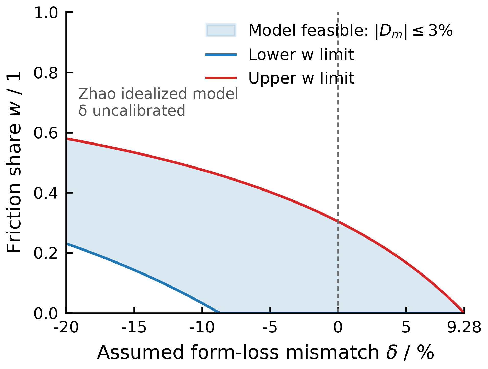

# 源无关界 v5 复核：解析包络的适用域与真正的双侧设计判据

**2026-11-02。** 使用 `norman-research-idea` 的证据与反例框架，逐条复跑上传的 v5 脚本、HTML 和日志；完整运行借用了仓库已有的四段模型修订依赖。**204 行日志逐行一致。**本轮保留 v5 的参数化思路，并把其“对所有 `δ`”“3% 硬上限”的量词与双侧判据算清楚。Xu 原文此前已直接核读；Yue 2017 全文仍未提供，文献表号继续按**待核转述**处理。

## 选用了什么，依据是什么

| 选择 | 依据 | 解决的问题 |
|---|---|---|
| 在 v5 同一 Zhao 变物性方程中固定目标 `x=.97/1.03` | `|D_m|≤3%` 是两侧目标，且 `G=(1−w)(1+δ)+wf(x)` 对 `w` 为仿射函数 | 直接反解可行 `w` 区间，避免把负向失真漏掉 |
| 检查 `M(x)=c_{p,R}/ρ_R` 的温度范围 | v5 上界用 `M≤1`，却写“所有 `δ>−1`” | 明确参数化解析界在哪些解上成立 |
| 对 v5 的阈值和区间函数做同模型反例 | 程序已给数值端点，能检验“必要条件”“精确等价”是否被误写 | 区分保守界、精确边界与未用到的代码缺陷 |

## 可保留：一个有条件的 `δ` 参数化上界

在 Zhao 声明模型中令 `A=1+δ>0`、`B=(R_id d)^n>1`、`x=1+D_m`、`M(x)=c_{p,R}(x)/ρ_R(x)`，且 `λ/d=1`。**若所考察的正根所处物性区满足** `M(x)≤1`、`μ_R(x)≤1`（对 `x≥1`），则由

`x³=M(x)[(1−w)A+w f(x)] ≤ (1−w)A+w Bxⁿ`

可得 `x≤max{A^(1/3), B^(1/(3−n))}`。这一步确实不必扫描 `w`，也不必先设 `δ` 的单个数值。v5 的 `δ=.35` 上界 `+10.5209%` 紧贴数值端点 `+10.5176%`，有设计解释价值。**正确标题句是“在指定物性有效域及 `M≤1` 等条件下的 `δ` 参数化模型界”**；它仍不是给任意未知局阻的单个数值保证。

下界还能比 v5 写得更清楚。对 `0<x<1`，若 `T_M(x)≤T_P`，则该物性式给 `M(x)≥1, μ_R(x)≥1`，从而 `f(x)=Bxⁿμ_R(x)^n ≥Bxⁿ>x³`（`B>1,0<n<3`）。若 `δ≥0` 且 `x<1`，则 `A≥1>x³`；若 `−1<δ<0` 且 `x<A^(1/3)`，也有 `A>x³`。两种情况都使凸组合 `(1−w)A+w f(x)>x³`，再乘 `M≥1` 与方程矛盾。因此，在这些物性前提下，

`min{0,A^(1/3)−1} ≤ D_m ≤ max{A^(1/3),B^(1/(3−n))}−1`。

**下界不需要** v5 额外声称的“全域 `(λ/d)f≥1`”。它只须对 `x<1` 有 `f(x)>x³`。取 `δ=−.99` 时，v5 自己的 `w=0` 根约 `x=.215501`，该点 `f≈.909520<1`，已经反驳“`f≥1` 覆盖所有 `δ>−1`”，但修正后的下界证明仍可成立。

“**对所有 `δ>−1`**”作为不带物性域条件的数学断言则过强。按同一 Zhao 多项式物性继续外推，取 `w=0,x=6` 时 `T_M≈930.38 K`、`M≈1.000927>1`；由方程反定 `δ≈214.799858`，v5 公式给的上限却是 `x≈5.998146<6`。这是**数学量词的反例**，并非物理可行设计：该温度已超出本研究所用的低温验证区。它恰好说明上界必须附 **`M≤1`/物性有效域**，不能用“δ 是自由参数”省掉模型适用域。[复核脚本](source-free-v5-audit-20261102.py)列出计算。

## 真正的 `|D_m|≤3%` 判据是一个 `w` 区间

v5 把判据写成“`δ≤9.2727%` 且 `w≤w*(δ)`”。这对**负 `δ`** 漏了 `D_m<−3%` 分支，对正 `δ` 又把恒物性立方根条件错称变物性模型的“硬上限”。在 Zhao 模型的目标带 `x∈[.97,1.03]` 内，设 `K_t=x_t³/M(x_t)`、`f_t=f(x_t)`，由方程在**固定目标 `x_t`** 处直接反解：

`w_t(δ) = [K_t−(1+δ)]/[f_t−(1+δ)]`，取 `x_t=.97` 与 `1.03` 分别得到 `w_−(δ)`、`w_+(δ)`。

在当前目标带内 `f_t` 大于可行 `1+δ`，且 `F_x>0`，于是可行设计域为

`max(0,w_−(δ)) ≤ w ≤ min(1,w_+(δ))`，并要求左端不超过右端。

只需在两个**固定目标点**求一次物性/温度，之后 `δ` 的影响就是上式的显式有理函数。数值核查：`K_−=0.912648800525`、`K_+=1.092755604047`，`f_−=1.288319247874`、`f_+=1.305130341205`。

| δ | `D_m(w=0)` | 可行 `w`，使 `|D_m|≤3%` |
|---:|---:|---:|
| `−0.20` | `−7.1662%` | **`[0.23069,0.57956]`** |
| `−0.10` | `−3.4501%` | **`[0.03257,0.47579]`** |
| `−0.09` | `−3.0939%` | `[0.00700,0.46252]` |
| `0` | `0%` | `[0,0.30399]` |
| `+0.07` | `+2.2802%` | `[0,0.09678]` |
| `+0.09274` | **`+2.9995%`** | `[0,0.00007347]` |

因此“`δ≤0` 时判据不变”**错误**：`δ=−.10,w=0` 已失真 `−3.45%`，却可在 `w≈0.033～0.476` 满足要求。v5 所称正向“硬上限” `1.03³−1=0.092727` 只是忽略 `M` 的保守近似；真实变物性模型在 `w=0` 达 `+3%` 的阈值为 **`1.03³/M(1.03)−1≈0.092755604`**。`δ=.09274` 已超过它所称硬上限，仍有可行 `w`，直接构成反例。这里的“可行”仅指 Zhao 声明模型与 3% FoM 目标，不代表 `δ` 已由装置证据确定。

{width=8.5cm}

可单独下载这张图的 [矢量 PDF](zhao-three-percent-design-region-20261102.pdf)、[SVG](zhao-three-percent-design-region-20261102.svg) 和 [600 DPI PNG](zhao-three-percent-design-region-20261102.png)；[绘图脚本](plot-zhao-three-percent-design-region-20261102.py)从下方 CSV 重生。图按**论文单栏 8.5 cm**制作，不把未标定的 `δ` 画成真实公差分布。

## 两个 δ 阈值之差的归因与一个潜伏代码错

v5 的端点交换阈值 `δ_num≈0.323077721` 与解析上界换支阈值 `δ_ana≈0.327848828` 数值均可复现；但二者相差 `0.004771107` **不是“恰好为 `1−M(x₁)` 的三倍”**。精确分解为

`δ_ana−δ_num = [x̄³−x₁³] + x₁³[1−1/M(x₁)]`

`= +0.004882331 − 0.000111224 = 0.004771107`。

主项是解析上界 `x̄` 与实际摩擦端点 `x₁` 的**根间隙**，物性比只修正较小一部分。论文里应称前者“保守包络造成的阈值间隙”，不要全部归因物性。

`F_dep_iv()` 的注释称 `G=1+w[(λ/d)f−(1+δ)]` 与原式等价；原式实际是 **`G=(1+δ)+w[(λ/d)f−(1+δ)]`**。取 `δ=.1,w=0,x=1`，原残差约 `−0.1`，`F_dep_iv` 返回近 `0`。当前 v5 只在 `δ=0` 的 KYLIN 根管里调用它，所以**本轮所印 KYLIN 根管结果未被此错污染**；今后拿它证明非零 `δ` 时必须先修。

## 资料边界与下一步

v5 对 KYLIN 根管、`m_R=.268` 舍入、Zhao `δ=0` 紧条件证书和 Xu 表 2 无逐段阻力数字的更正可保留。**“`K_EV/K_HS/K_pipe` 出自 Yue 2017 表 2”目前仍是转述**：本轮未上传 Yue 全文，无法核表头、系数口径与功率条件。即使它是同一装置的逐段阻力分解，也需**原型与台架两侧**的阻力或制造公差，才有 `δ=k_M/k_P−1` 的来源域；一侧数据可帮助 `w`，不能单独给 `δ`。

下一轮可直接把上面的 `w_−(δ),w_+(δ)` 画成**声明模型的 3% 可行域**；横轴必须标“未标定的局阻失配参数 `δ`”，纵轴标 `w`，并附物性有效域。与此同时继续寻找 Li/Yue 原文与成对压降数据。参数化图能推进**方法**，物理 `δ` 域则决定能否宣称某个具体台架“保证 ≤3%”。

已附 [81 个 δ 情景点的可行域 CSV](zhao-three-percent-design-region-20261102.csv)，从 `−0.20` 到当前变物性模型的正向临界值 `+0.092755604`；它用于画**模型条件曲线**，不是装置制造公差分布。可由下方核查脚本的 `--csv` 参数重生。

## 文件与复现

- [v5 原脚本归档](source-free-v5-upload-20261102.py)、[204 行原日志](source-free-v5-upload-log-20261102.txt)、[原 HTML 报告](source-free-v5-upload-report-20261102.html)。完整运行依赖仓库的[四段修订脚本](loop-audit-repair-corrected-20261101.py)，需复制到同目录并命名 `loop_audit_repair.py`。
- [本轮独立核查脚本](source-free-v5-audit-20261102.py)复现两侧设计带、两个 δ 阈值分解、`F_dep_iv` 的非零 δ 反例与物性外推边界；用标准库。
- Xu FR26-170 与 LFR-21 原件仍可从[研究交接文件](research-handoff-20261102.md)进入；Yue 2017 原文未上传，本轮没有把未见的表 2 当已核证据。

分析采用 norman-paper-reading 技能｜作者：N同学｜小红书：N同学｜B站/抖音：耐心的N同学

Analysis performed using the norman-paper-reading skill | Author: N同学 | Xiaohongshu: N同学 | Bilibili/Douyin: 耐心的N同学
