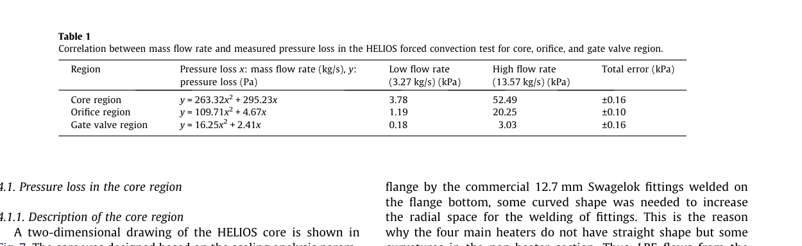

# 油侧输入域与两篇新文献复核（v29）

**结论。** v29 的环隙雷诺数恒等式、所选条件下的混温计算和 6 kW 数值对账可以保留。两篇新论文加强了**回路阻力分段建模的依据**，没有给出本模型油品的黏度、环隙换热关联式或混温执行器的性能。因此，0.50 kg/s 油循环和 76% 的换热能力余量应写成**声明设计下的条件结果**；尚不能写成已经测得或跨设备适用的物理参数域。

## 1. 两篇原文实际补上了什么

### 吴磊等（2016）：阻力机制与方法依据

原文：吴磊等，《自然循环系统流动-阻力特性理论和实验研究》，《核动力工程》37(3):10–15，DOI `10.13832/j.jnpe.2016.03.0010`，PDF 第 1–6 页。对象是 **NHR-200Ⅱ / HRTL-200Ⅱ** 自然循环系统，原文表 1 写明 7 MPa、堆芯入口 230 °C、出口 278 °C；这不是 KYLIN-II 的 LBE 构件实验。

原文将局部损失和沿程损失分开，令 `f=a Re^(-b)`，再讨论流量对功率的指数 `m` 如何随局阻/沿程比 `R_n` 变化（式 7–17）。在三种加热段入口局阻 `k=2.61/5.13/14.39` 下，报告的 `m=0.367/0.352/0.308`（正文第 11–12 页）。这能支持本文把**构件阻力份额和 Re 依赖**作为摄动、GSA 的变量；不能把三种 `k` 或文中示例的 `b∈[0.25,1]`、`R_n∈[0.01,100]` 搬作当前 LBE 回路的实物不确定度区间。该文推导还声明忽略散热并把局阻近似为常数，使用时须保持这些前提。

### Cho 等（2011）：LBE 构件压降的直接旁证

原文：Cho et al., “Benchmarking of thermal hydraulic loop models for Lead-Alloy Cooled Advanced Nuclear Energy System (LACANES), phase-I: Isothermal steady state forced convection”, *Journal of Nuclear Materials* **415** (2011):404–414；PDF 第 5 页、印刷第 408 页的表 1 是 **HELIOS 回路 250 °C 的 LBE 强制循环实测**。下面是该表的原图；其中 `m` 单位为 kg/s、`Δp` 单位为 Pa。

| HELIOS 测压段 | 原文拟合 `Δp(m)` | 3.27 kg/s | 13.57 kg/s |
|---|---:|---:|---:|
| 堆芯段 | `263.32m² + 295.23m` Pa | 3.78 kPa | 52.49 kPa |
| 孔板段 | `109.71m² + 4.67m` Pa | 1.19 kPa | 20.25 kPa |
| 闸阀段 | `16.25m² + 2.41m` Pa | 0.18 kPa | 3.03 kPa |

这证明 LBE 回路可按构件**测压、拟合并审计**；它也说明不同构件的压降曲线各异。它不提供本设计 10/16 mm 孔板、4 mm 油环隙或隔离阀的 `K(Re)`。作者在 §4.2 推荐用于 HELIOS 孔板的 Idelchik 式（式 9）原图明确标了 **`Re ≥ 10⁵`**；本模型的约 `10⁴` 不能凭该式或文中“约 10%”的 HELIOS 高流量比较来定误差界。本文只报告 LACANES **phase I 等温强制循环**，并未报告本回路的自然循环热边界或油侧换热验证。

## 2. v29 算术与推断分开记

| v29 项 | 复核判断 | 该如何写 |
|---|---|---|
| 环隙 `Re=4ṁ/[πμ(D_i+D_o)]` | 代数正确。`D_i=20 mm`、外径 28 mm、`ṁ=0.50 kg/s`、`μ=1.0 mPa·s` 时 `Re=13263` | 是**所声明油黏度**下的雷诺数；间隙趋零的数学上限不构成可制造方案，因为面积同时趋零、压降上升。 |
| `Re≥10⁴` 所需 `ṁ≥0.377 kg/s` | 在同一黏度和 4 mm 间隙下正确 | 一般式是 `ṁ_min=π μ(D_i+D_o)10⁴/4`。若固定 0.50 kg/s，需油在该换热段工作温度内满足 **`μ≤1.326 mPa·s`**；还须核对环隙换热式本身的几何与热边界适用性。 |
| 混温后油入口 466.5→450.2 K，`UA=73.2→74.7 W/K` | 与所给脚本/日志一致 | 是 433.15 K 冷源、0.50 kg/s 循环、所取油物性及理想混温控制下的**前向算例**。`h_o=2233 W/(m²·K)` 为关联式预测，**不是测量值**。 |
| 6 kW 流量 0.265118→0.272705 kg/s | 改粗糙度、辅助阻力、热损记法后的顺序复算与日志一致；与 0.273200 相差约 0.18% | 说明先前约 3% 的差距主要来自输入口径不一致；剩余 0.18% 的成因**尚未隔离**，不能径直归给“集总温度与沿程温度”。 |
| `UA` 可下降到约 76% | 在 6 kW 的名义控制模型中，冷油入口达到 433.15 K 的饱和边界 | 这是**单一温度、功率和油品假设**下的控制余量，须逐工况重算；不可写作油侧换热模型的普适误差容许值。 |
| 1 m 油环隙泵功 4.4 W | `Δp·ṁ/ρ=6.6 kPa×0.50/750≈4.4 W` | 仅为该直段**理想水力功**，未计混温阀、管路、冷机、泵效率；不能据此说整套油路泵耗已无约束。 |

**另一个数值细节：**v29 §4 的 `dlnK/dlnṁ=−0.2345` 是脚本中写死的常数，未由当前工况求导。在 4.3 kW、`ṁ≈0.22982 kg/s`、固定该点平均温度时，对脚本 `K_of` 做中心差分得到约 **−0.23776**。两者对所报 1% 流量的热量换算影响小，但那一行应改为计算值，或标“示意近似”，不能称为求解器推得的精确局部斜率。

## 3. 油侧输入域怎样才算封口

目前可写为一条**独立设计的条件域**：16 mm LBE 圆管外套 4 mm 油环隙、433.15 K 冷油源、名义油循环 0.50 kg/s，以混温控制 LBE 冷端入口 473.15–483.15 K；加热功率 3–6 kW。这个设定无需为满足缩放准则而反解阀门或热量。

还应在输入表中明确以下可检查条件，才能把上述名义点推广成可求界的域：

1. **油品与物性曲线**：给出牌号，以及 `μ(T)、k(T)、c_p(T)、ρ(T)` 的厂商数据和适用温区；按油在换热器内的实际温度复算 `Re`。0.50 kg/s 的 `μ≤1.326 mPa·s` 是当前几何和 `Re≥10⁴` 门槛下的**设计规格**，不是已有油品的性质。
2. **油侧换热模型**：Dittus–Boelter 以圆管充分发展湍流为常见基准。当前为**同心环隙**，仅超过 `Re=10⁴` 不足以把该公式的常见精度移植过来；应列出环隙适用的 `Nu(Re,Pr,D_i/D_o,L/D_h)` 关联式及其边界，或把油侧关联式列为离散模型分支。文档所称“D–B 残差 10–15%”在这套油环隙上没有已核原文依据。
3. **控制可行域**：在每个功率和参数角点，以 `0≤冷油掺入量≤循环油量`、冷源温度、允许回油温度、冷机排热能力和可达到的 `UA` 判定是否能维持目标 `T_H,in`；只报告满足这些物理谓词的状态。`h_o` 在**理想且未饱和的定温控制**下对该点流量 FoM 的直接导数可为零，但它改变**可行集与饱和边界**，不能从整个先验求界中删除。
4. **传热式适用域**：v29 内侧使用 NEA 所列的 LBE 圆管推荐式。旧核对已指出模型低功率端 `Pe<300`，因此该式在该端属于外推；手册的 **8.7% RMS 是该 LBE 侧关联式的拟合统计量，不是油侧 `h_o` 的误差条**。需把相关换热式的适用域谓词及模型形式分支与控制可行域一起报告。

“只有两条路线”应改为“当前已计算两条路线”：提高油流量并混温，或延长换热段并改用适合低 Re 的关联式。增大换热面积、改变油侧流道、改变冷源条件等仍可作为独立设计选项，但都须正向核算。对于混温路线，**阀卡冷和冷源不足分别对应过冷、过热**，不应只保留一个失效方向。

## 4. 对论文主线的影响

这两篇文献**没有要求回到 H2TS 配平**。它们让“分段阻力由物理模型正向求得”更有依据，同时提示移植条件必须写清。现阶段可先固定一套明示的几何、油品与控制器规格，分别前向求解原型和模型，再对每个**可行输入点**计算 FoM；摄动用于识别能使极值移动的变量，GSA 用于给定分布下的驱动因子排序，极值求界另行用角点单调性或区间/全局优化完成。**随机采样得到的最大样本值不是数学上界**。

当前最有信息量的下一份材料是**拟选导热油的技术样本**（至少黏度随温度、导热率、比热、密度），其次是**环隙换热器几何与控制规格**。Cho 的 HELIOS 表 1 可引用作 LBE 构件压降审计的先例；吴磊式可引用作局阻/沿程份额影响自然循环指数的理论与实验支持。两篇均不能替代油品数据。

## 来源与复核范围

- 用户上传《自然循环系统流动-阻力特性理论和实验研究_吴磊.pdf》，核对摘要、表 1、式 1–17 与实验说明；本文未核其所有参考文献。
- 用户上传 Cho 等 2011 完整 PDF，核对摘要、Table 1 原图、§4.2 式 9 原图及 phase-I/II 界限；本报告未将其 HELIOS 几何换算成当前设备的 `K`。
- 用户上传 `油侧输入域与6kW对账_2026-11-09.md`、`probe_v29_oil.py`、日志；检查关键输入、打印表和局部斜率，并对雷诺数、泵功作独立代数复算。未对完整耦合求解器做区间认证。

分析采用 norman-paper-reading 技能｜作者：N同学｜小红书：N同学｜B站/抖音：耐心的N同学
Analysis performed using the norman-paper-reading skill | Author: N同学 | Xiaohongshu: N同学 | Bilibili/Douyin: 耐心的N同学
