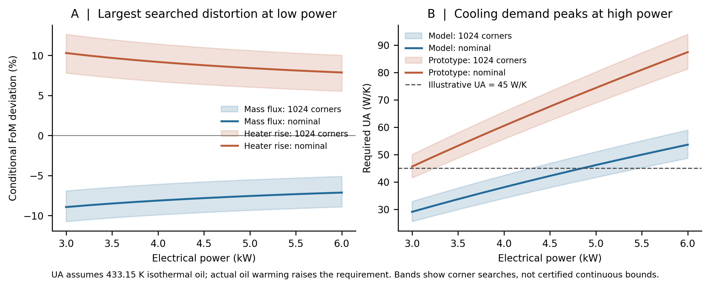

# 先验失真 v3：功率窗、双 FoM 与冷源条件复跑

日期：2026-11-09。此件是对 WorkBuddy `core_v2.py` 的追加复跑，沿用它的十轴声明输入盒和 P/M 双侧前向方程；不重新配平几何或阻力。

## 1. 计算对象和口径

- P：Yue 2017 KYLIN-II TH 几何；阻力取 Yue Table 2 的分段线性 `K(Re)`。M：独立声明的 16 mm、16 m 回路，含 10×2 mm 孔板和四个斜接弯头。
- 两侧电功率相同，3–6 kW；加热段入口温度各受控在 473.15 K，允许各自按输入盒偏移。面积比 `A_M/A_P=(16/26)^2` 在求解前固定。
- 流量 FoM：`D_j=(ṁ_M/A_M)/(ṁ_P/A_P)-1`。温升 FoM：`D_T=(A_M/A_P)(ΔT_HS,M/ΔT_HS,P)-1`。后者是**加热段出口体温减入口体温**，不是壁温，也不是独立验证；两者由加热段能量式强耦合。
- 逐功率遍历十轴盒的 `2^10=1024` 个角点，功率间隔 0.25 kW，共 13 个功率点，全部找到求解器返回的根。图中的带只是**搜索到的角点范围**，不构成连续功率或连续十维盒的严格包络。

## 2. 新的复跑结果

| 功率 | 名义 `D_j` | 角点 `D_j` | 名义 `D_T` | 角点 `D_T` | M 冷源所需 `UA`，角点 |
|---:|---:|---:|---:|---:|---:|
| 3.00 kW | −8.9395% | [−10.7389%, −6.9103%] | +10.3070% | [+7.8092%, +12.6496%] | 25.5–32.9 W/K |
| 4.25 kW | −7.9696% | [−9.7511%, −5.9295%] | +8.9745% | [+6.5514%, +11.2031%] | 36.0–44.6 W/K |
| 6.00 kW | −7.1316% | [−8.9087%, −5.1040%] | +7.8773% | [+5.5395%, +10.0280%] | 48.6–59.0 W/K |

4.3 kW 单点另核：`D_j=−7.9390%`、`D_T=+8.9337%`，与 WorkBuddy v3 对齐。13 个功率格点上，最负的流量偏差及最大的温升偏差都出现在 **3 kW**；冷却器所需能力则随功率增大，在 **6 kW** 最紧。应把两端分别作为“失真端”和“设备可行性端”，不能只展示 6 kW 极值。

## 3. 冷源算例的含义

按 `T_oil,in=433.15 K` 且油**等温**的理想换热边界，以 LBE 冷却段进出口温度和冷却负荷反算的 `UA_req=Q_c/LMTD`，名义 M 值为 29.1/40.6/53.6 W/K（3/4.3/6 kW）。理想 45 W/K 情景在 3 kW 的 1024 个角点全部通过，在 6 kW 全部不通过；理想 70 W/K 情景在两端全部通过。P 侧 6 kW 的角点所需值为 81.3–94.0 W/K。

**这只是需求，不是已具备的换热能力。** 给油侧另设 `ṁ_oil=0.50 kg/s`、`c_p,oil=2300 J/(kg·K)`、433.15 K 油入口，并按逆流有限油温升重算，所得必要 `UA` 为：

| 功率 | P 侧角点 | M 侧角点 |
|---:|---:|---:|
| 3 kW | 42.15–50.98 W/K | 25.75–33.23 W/K |
| 6 kW | 83.67–97.11 W/K | 49.35–59.99 W/K |

有限油温升只改变该**示例**的需求约 1–3 W/K。油路流量、油品物性、换热器面积与流道、冷机容量和控制方式仍未由本版确定，因而不能把“70 W/K 通过”写为已满足设备谓词。核心求解器仍是“先指定 LBE 入口温度，再由能量平衡反算冷却负荷”；它没有求解油侧。这里是对指定入口条件的事后可行性筛查。

## 4. 新进展、新阻碍和线索

**新进展。** 两个已定义 FoM、功率轴与冷源负荷已经放进同一张账；1024 角点 × 13 功率格点无求根失败。流量最坏和冷却器最紧分处功率窗两端，是一个可以直接指导正文结果排列的发现。3 kW 端的 M 主流道 Re 角点为 6877–9196，6 kW 为 9660–12866；P 对应 11461–14726 与 15244–19533。所见根远离 Churchill 在约 3116 的过渡峰，但这不证明盒内所有根唯一。

**新阻碍。** 当前模型给的是受控冷入口下的**条件**先验预测；缺冷源实体规格，不能证明该温度在整个盒与功率窗都能维持。角点搜索也不能替代连续域上界证书。加热段壁温 FoM 仍需受热面、两侧低 Pe 换热分支与固体热阻，现有 `D_T` 只能代表流体体温。3 kW 低于 Yue 4.3 kW 实测功率，属于方法声明域的外推，不能称已被该点验证。

**新线索。** 最有效的下一步是把冷源可行性写成独立谓词：给定油入口、油流量、油物性与换热器几何，前向计算可用 `UA`，检查 `UA_available ≥ UA_required`。求界则先对只进阻力项的 `K_aux`、粗糙度和孔径做隐函数导数定号，再处理 `K_P(Re)` 的分段折点与热物性轴。该办法有望显著减少全盒分支数；目前尚未形成认证证明。

## 5. 复现与交付

运行 `python power_cooling_scan_v3_20261109.py` 生成 CSV、JSON 与日志；运行 `python plot_power_cooling_v3_20261109.py` 出 SVG/PNG。脚本依赖同目录上传的 `core_v2.py` 及 NumPy、Matplotlib。原始数据见 CSV，JSON 标出格点最坏位置。此件没有重跑 Sobol；WorkBuddy v2 的 GSA 排序仍只适用于原十轴分布和当时输出定义。
